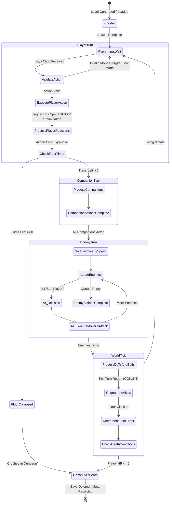
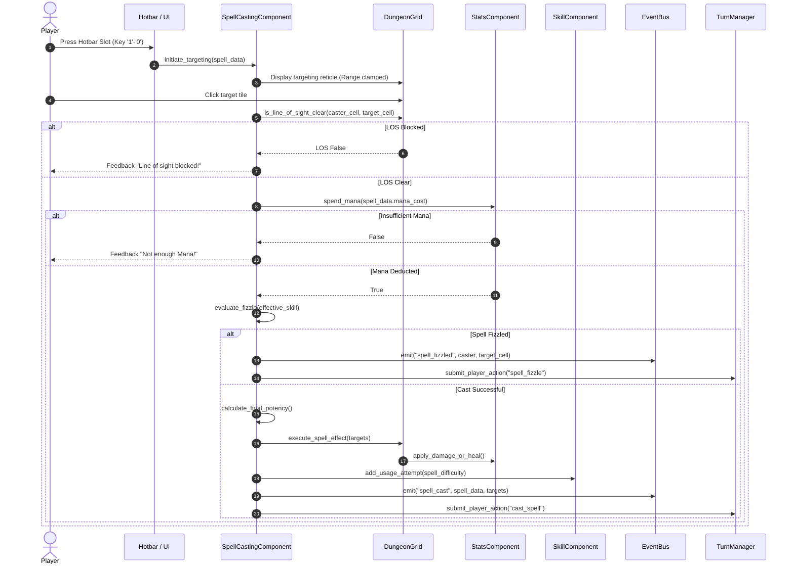
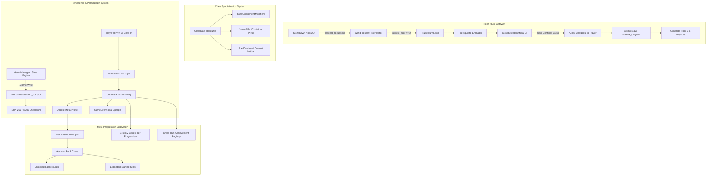
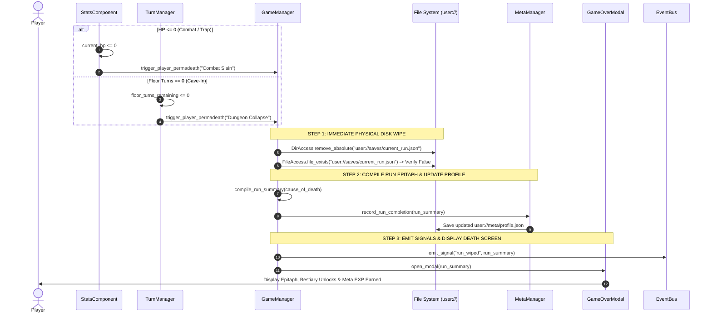
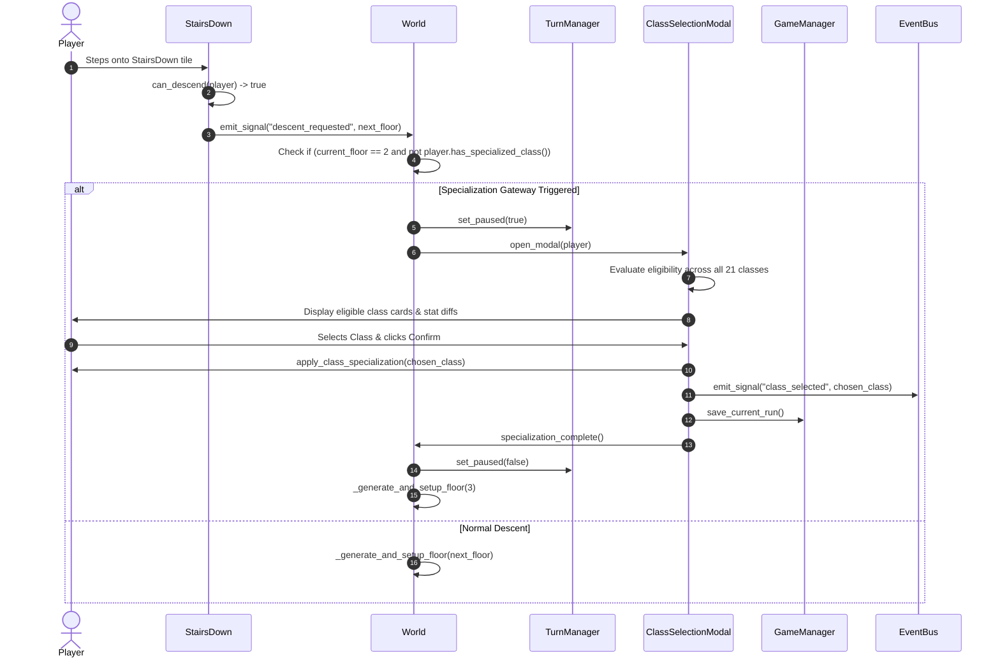
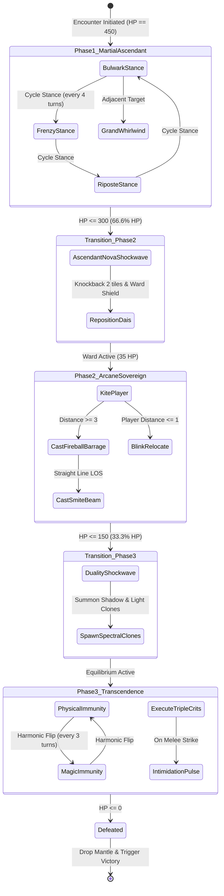
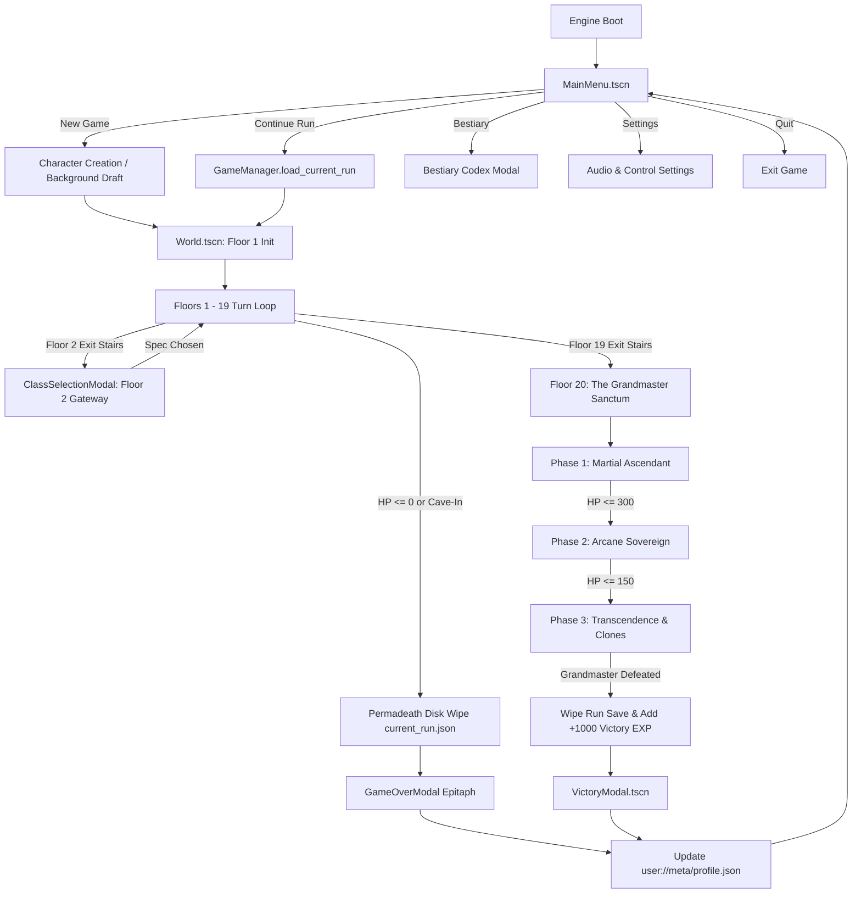

# Architecture Design Document: Trail of the Grandmaster

**Project Name:** Trail of the Grandmaster  
**Engine:** Godot Engine 4.x (Forward+ / D3D12 / GDScript 2.0)  
**Genre:** Turn-Based Grid Roguelike (Top-Down 2D, Gritty Pixel Art, Retro Synth)  
**Document Version:** 1.7.0 (Phase 7 Final Systems Architecture Integrated)  
**Status:** Approved Architectural Blueprint  

---

## 1. Executive Summary & Design Pillars

*Trail of the Grandmaster* is a turn-based tactical dungeon crawler blending dark fantasy and modern elements (swords, firearms, arcane sorcery, divine devotion, and tactical gear). Players traverse 20 progressively lethal, procedurally generated dungeon floors under the relentless pressure of a collapsing floor turn-clock.

### Core Pillars
1. **Dual Progression System (Skills & Attributes):**
   - **Use-Based Skill Mastery (0.0 to 100.0):** Skills level through direct, contextual usage with 0.1 increments and milestone keystone perks at 25, 50, 75, and 100.
   - **Kill Experience & Core Attribute Growth:** Slaying monsters and floor bosses awards Character Experience (EXP). Reaching new character levels grants Attribute Points for the player to permanently raise their 6 core attributes (Strength, Dexterity, Constitution, Intelligence, Wisdom, Charisma), immediately cascading into increased HP, Mana, damage, stone carry weight, crit chance, and effective skill calculations.
2. **Deterministic & Transparent Math:** Predictable combat and evasion formulas based on relative skill differentials and attribute scaling.
3. **Organic Character Growth:** Characters begin as raw survivors defined by 4 background skills and initial attribute distribution; class specialization is earned dynamically at the conclusion of Floor 2 based on achievements, skills, and attributes.
4. **Relentless Environmental Pressure:** Floors are spacious and rich in secrets, but every step expends the floor collapse timer, forcing a risk-reward dilemma between deep exploration (boss vaults, shrines, merchants) and prompt descent.
5. **Decoupled, Data-Driven Architecture:** Pure Godot 4 `Resource`-driven definitions for stats, skills, items, classes, deities, spells, companions, shops, and dungeon generation tables, ensuring rapid extensibility.

---

## 2. High-Level System Architecture

The game follows a decoupled **Model-View-Controller / Event-Driven** paradigm in Godot 4. Simulation logic (turn calculation, stat scaling, inventory weights, combat resolution, spellcasting) is completely decoupled from visual representations (sprites, tweens, particles, floating damage numbers).

```mermaid
graph TD
    subgraph Core Singletons (Autoloads)
        EB[EventBus: Global Signal Hub]
        GM[GameManager: Run & Session State]
        DB[DataManager: Resource Registry]
        AM[AudioManager: Retro Synth Engine]
    end

    subgraph Scene Tree
        Main[Main / GameRoot] --> World[World2D / DungeonScene]
        Main --> UILayer[UI / CanvasLayer]
        
        World --> GridMapController[Grid / TileMapLayer System]
        World --> TurnManager[TurnLoopStateMachine]
        World --> EntityContainer[Entity Container]
        World --> MapFeatures[Interactables & Shrines]
        
        EntityContainer --> Player[Player Entity]
        EntityContainer --> Enemies[Enemy Entities]
        EntityContainer --> Companions[Companions & Pets]
        MapFeatures --> ShrineNode[Deity Shrines]
        MapFeatures --> MerchantNode[Travelling Merchants]
        
        UILayer --> HUD[HUD & Floor Timer Bar]
        UILayer --> Hotbar[Hotbar Controller]
        UILayer --> InventoryUI[Inventory & Weight Sheet]
        UILayer --> Modals[Modals: Shrine, Class Select, ShopModal]
    end

    Player -. Signals .-> EB
    Enemies -. Signals .-> EB
    Companions -. Signals .-> EB
    ShrineNode -. Signals .-> EB
    MerchantNode -. Signals .-> EB
    TurnManager -. Direct Action Cycle .-> EntityContainer
    EB -. State Notifications .-> HUD
    EB -. Events .-> AM
```

### Global Autoload Singletons (`res://scripts/autoload/`)
- **`EventBus.gd` (`EventBus`):** Central nervous system for decoupled inter-system signals (e.g., `skill_xp_gained`, `entity_damaged`, `entity_died`, `floor_turn_ticked`, `shrine_activated`, `spell_cast`, `shop_opened`, `modal_opened`).
- **`GameManager.gd` (`GameManager`):** Manages meta-progression, current run seed, active floor number (1 to 20), permadeath resets, and serialization (save/load).
- **`DataManager.gd` (`DataManager`):** Registry and loader for static resources (Items, Skills, Classes, Shrines, Spells, Companions, Shops, Loot Tables, Enemies).
- **`AudioManager.gd` (`AudioManager`):** Manages retro-synth soundtrack layers, dynamic tension cues, and audio SFX.

---

## 3. Node & Scene Tree Structure

The project uses Godot 4's nested scene composition. All gameplay entities inherit from a shared base and utilize modular nodes.

```
res://
├── scenes/
│   ├── main/
│   │   ├── Main.tscn                    # Root scene, manages active scene switching
│   │   └── Main.gd
│   ├── world/
│   │   ├── World.tscn                   # Active floor container
│   │   ├── World.gd
│   │   ├── TurnManager.tscn             # Turn loop orchestrator
│   │   ├── TurnManager.gd
│   │   ├── DungeonGrid.tscn             # Grid coordination & AStar2D pathfinding
│   │   └── DungeonGrid.gd
│   ├── entities/
│   │   ├── base/
│   │   │   ├── BaseEntity.tscn          # Base CharacterBody2D with components
│   │   │   └── BaseEntity.gd
│   │   ├── player/
│   │   │   ├── Player.tscn              # Player Controller & camera
│   │   │   └── Player.gd
│   │   ├── enemies/
│   │   │   ├── Enemy.tscn               # AI Entity template
│   │   │   └── Enemy.gd
│   │   └── companions/
│   │       ├── Companion.tscn           # Hired mercenary / tamed hound
│   │       └── Companion.gd
│   ├── environment/
│   │   ├── Shrine.tscn                  # Deity altar interactable
│   │   ├── Shrine.gd
│   │   ├── SecretDoor.tscn              # Hidden wall / door
│   │   ├── Trap.tscn                    # Hidden tile hazards
│   │   ├── StairsDown.tscn              # Level descent transition
│   │   ├── Merchant.tscn                # Travelling trader NPC
│   │   └── Merchant.gd
│   └── ui/
│       ├── UI.tscn                      # CanvasLayer master
│       ├── hud/
│       │   ├── HUD.tscn                 # HP/Mana bars, Floor Timer, Minimap
│       │   ├── ExperienceBar.tscn       # Character EXP progress toward next level
│       │   ├── Hotbar.tscn              # 1-0 Quickslots for skills/items/spells
│       │   └── TurnCounterBar.tscn      # Visual collapse urgency meter
│       ├── menus/
│       │   ├── CharacterSheet.tscn      # Attributes, Skills (0-100), Stances
│       │   ├── LevelUpModal.tscn        # Attribute point allocation dialog on level up
│       │   ├── InventoryView.tscn       # Grid view, Weight capacity indicator
│       │   ├── ClassSelectionModal.tscn # Post-floor 2 specialization
│       │   ├── ShrineModal.tscn         # Blessing vs Taboo interaction
│       │   └── ShopModal.tscn           # Dynamic buy/sell mercantile interface
│       └── components/
│           ├── FloatingText.tscn        # Damage/XP/Miss/Mana feedback
│           └── Tooltip.tscn
├── scripts/
│   ├── autoload/
│   │   ├── EventBus.gd
│   │   ├── GameManager.gd
│   │   ├── DataManager.gd
│   │   └── AudioManager.gd
│   ├── components/
│   │   ├── StatsComponent.gd            # Vitals, Attributes, Mana, HP, Regen
│   │   ├── SkillComponent.gd            # Decimal 0-100 skills, XP sweet spots
│   │   ├── InventoryComponent.gd        # Item slots, Stone weight capacity
│   │   ├── StatusEffectContainer.gd     # Buffs, Taboos, DoTs, Wards
│   │   ├── CombatComponent.gd           # Hit chance, multi-crit, armor soak
│   │   ├── VisionComponent.gd           # Bresenham LOS raycasting, perception
│   │   └── SpellCastingComponent.gd     # Targeting, LOS, mana deduction, fizzle roll
│   └── resources/
│       ├── AttributesData.gd            # Core 6 attributes & derived formulas
│       ├── SkillData.gd                 # Individual skill progression resource
│       ├── ItemData.gd                  # Weapons, armor, consumables, weight
│       ├── ClassData.gd                 # Specialization definitions
│       ├── SpellData.gd                 # Arcane & Divine spell specifications
│       ├── ShrineData.gd                # Deity pantheon, blessings & taboos
│       ├── CompanionData.gd             # Mercenary & hound stat presets
│       └── ShopData.gd                  # Merchant inventory catalogs & tiers
```

### TileMap Architecture (Godot 4.x `TileMapLayer`)
Rather than legacy monolithic TileMaps, the dungeon renderer uses dedicated `TileMapLayer` nodes within `DungeonGrid.tscn`:
1. `FloorLayer` (`z_index = 0`): Ground tiles, puddles, rubble.
2. `WallsLayer` (`z_index = 10`): Structural walls with physics collisions.
3. `DecalsLayer` (`z_index = 5`): Blood splatters, runes, scorch marks.
4. `HazardsAndSecretsLayer` (`z_index = 8`): Hidden traps, revealed switches, secret passages.
5. `FogOfWarLayer` (`z_index = 50`): Unexplored tiles (black) vs. explored-but-not-in-LOS (dimmed) using custom shaders.

---

## 4. Entity Component Model

Entities do not use deep inheritance; they are composed of specialized child nodes attached to a `CharacterBody2D` root (`BaseEntity.tscn`):

```
BaseEntity (CharacterBody2D)
├── VisualSprite (Sprite2D / AnimatedSprite2D)
├── CollisionShape2D
├── StatsComponent (Node)                 # Attributes, HP, Mana, Resistances
├── SkillComponent (Node)                 # 0-100 Skills, XP accumulators, Milestones
├── InventoryComponent (Node)             # Items, stones weight tracking, equipment
├── StatusEffectContainer (Node)          # Buffs, Debuffs, DoTs, Resistances, Deity Taboos
├── CombatComponent (Node)                # Hit/Crit/Damage calculations, Defense Stance
├── VisionComponent (Node)                # LOS Raycasting, Hide/Perception checks
├── SpellCastingComponent (Node)          # Spell targeting, mana spend, fizzle rolls
└── AnimationHandler (Node)               # Tween-based tile movement & attack bumps
```

---

## 5. Data-Driven Resource Architecture

All gameplay mechanics are driven by Godot `Resource` definitions (`.tres` and `.gd` scripts in `res://scripts/resources/`).

### 5.1. Attributes Resource (`AttributesData.gd`)
```gdscript
class_name AttributesData
extends Resource

@export_range(1, 100) var strength: int = 1
@export_range(1, 100) var dexterity: int = 1
@export_range(1, 100) var constitution: int = 1
@export_range(1, 100) var intelligence: int = 1
@export_range(1, 100) var wisdom: int = 1
@export_range(1, 100) var charisma: int = 1

# Base constants
const BASE_HP: float = 100.0
const BASE_MANA: float = 50.0
const STONES_PER_STR: float = 10.0
const BASE_WEIGHT_CAPACITY: float = 100.0 # at 10 STR

func get_melee_damage_modifier() -> float:
    # 10 STR = 1.0 (100%), +25% per 10 points (+2.5% per point)
    return 1.0 + (strength - 10) * 0.025

func get_ranged_damage_modifier(weapon_type: WeaponType) -> float:
    var full_bonus = (strength - 10) * 0.025
    match weapon_type:
        WeaponType.THROWN, WeaponType.SLING:
            return 1.0 + full_bonus
        WeaponType.HIGH_TENSION_BOW:
            return 1.0 + (full_bonus * 0.5)
        _:
            return 1.0 # Firearms and standard bows receive no STR bonus

func get_max_carry_weight_stones() -> float:
    # 10 STR = 100 stones, 10 stones per STR scaling infinitely
    return strength * STONES_PER_STR

func get_critical_chance() -> float:
    # 1.5% per point of Dexterity
    return dexterity * 0.015

func get_max_health() -> float:
    # 10 CON = 100% Base HP, +2.5% per CON point
    var mult = 1.0 + (constitution - 10) * 0.025
    return max(10.0, BASE_HP * mult)

func get_health_regen_modifier() -> float:
    # 10 CON = 1.0 (100%), +2.5% per point above 10
    return 1.0 + (constitution - 10) * 0.025

func get_skill_xp_multiplier() -> float:
    # No penalty below 10 INT, +2.5% per point above 10
    if intelligence <= 10:
        return 1.0
    return 1.0 + (intelligence - 10) * 0.025

func get_max_mana() -> float:
    # 10 INT = 100% Base Mana, +2.5% per INT point
    var mult = 1.0 + (intelligence - 10) * 0.025
    return max(0.0, BASE_MANA * mult)

func get_mana_regen_modifier() -> float:
    return 1.0 + (intelligence - 10) * 0.025

func get_shrine_multipliers() -> Dictionary:
    # Returns { "bonus_mult": float, "penalty_mult": float }
    var bonus_mult: float
    var penalty_mult: float
    
    if wisdom < 10:
        var deficit = 10 - wisdom # 1 to 9
        # 1 WIS = 90% less bonus, 90% more penalty
        bonus_mult = 1.0 - (deficit * 0.10)
        penalty_mult = 1.0 + (deficit * 0.10)
    else:
        var excess = wisdom - 10
        bonus_mult = 1.0 + (excess * 0.025) # +25% per 10 WIS
        penalty_mult = max(0.0, 1.0 - (excess * 0.025)) # 0% penalty at 50 WIS
        
    return { "bonus_mult": bonus_mult, "penalty_mult": penalty_mult }

func get_companion_stat_modifier() -> float:
    # 10 CHA = 1.0 (100%), +2.5% per point
    return 1.0 + (charisma - 10) * 0.025

func get_mercantile_modifier() -> float:
    # 10 CHA = 1.0 (100%), +1% per point above 10. 100 CHA = 1.90 (190%)
    return 1.0 + (charisma - 10) * 0.01

# Character Level & Kill EXP System
@export var character_level: int = 1
@export var current_exp: int = 0
@export var unallocated_attribute_points: int = 0
const BASE_EXP_REQUIREMENT: float = 100.0
const EXP_EXPONENT: float = 1.5
const POINTS_PER_LEVEL: int = 2

func get_exp_required_for_next_level() -> int:
    return int(BASE_EXP_REQUIREMENT * pow(character_level, EXP_EXPONENT))

func add_kill_exp(amount: int) -> bool:
    current_exp += amount
    var leveled_up: bool = false
    while current_exp >= get_exp_required_for_next_level():
        current_exp -= get_exp_required_for_next_level()
        character_level += 1
        unallocated_attribute_points += POINTS_PER_LEVEL
        leveled_up = true
    return leveled_up

func allocate_attribute_point(attr_name: String) -> bool:
    if unallocated_attribute_points <= 0:
        return false
    match attr_name.to_lower():
        "strength":
            strength += 1
        "dexterity":
            dexterity += 1
        "constitution":
            constitution += 1
        "intelligence":
            intelligence += 1
        "wisdom":
            wisdom += 1
        "charisma":
            charisma += 1
        _:
            return false
    unallocated_attribute_points -= 1
    return true
```

---

### 5.2. Skill Resource & System Specification (`SkillData.gd`)

Skills range from `0.0` to `100.0` and represent granular proficiency.

```gdscript
class_name SkillData
extends Resource

enum SkillId {
    # Melee (Associated with STR)
    SWORDSMANSHIP,
    MACE_FIGHTING,
    POLEARMS,
    BRAWLING,
    
    # Ranged & Agility (Associated with DEX)
    MARKSMANSHIP,
    ARCHERY,
    THROWING,
    DODGE,
    PARRY,
    STEALTH_HIDE,
    
    # Intellectual & Arcane (Associated with INT)
    ARCANE_MAGIC,
    ALCHEMY,
    SCHOLARSHIP,
    
    # Spiritual & Perception (Associated with WIS)
    DIVINE_MAGIC,
    PERCEPTION,
    MEDITATION,
    
    # Social & Leadership (Associated with CHA)
    INTIMIDATION,
    LEADERSHIP,
    BEAST_MASTERY
}

@export var skill_id: SkillId
@export var skill_name: String
@export var associated_attribute_name: String # "strength", "dexterity", etc.
@export_range(0.0, 100.0) var level: float = 0.0

# Keystone tracking
var unlocked_keystones: Array[int] = [] # [25, 50, 75, 100]

func get_effective_level(attr_value: int) -> float:
    # General formula: for every 2 points in attribute, +1 effective skill level
    # At 10 Attribute, bonus is +5.
    var attr_bonus = attr_value / 2.0
    return level + attr_bonus

func check_keystone_triggers() -> Array[int]:
    var newly_unlocked: Array[int] = []
    for milestone in [25, 50, 75, 100]:
        if level >= milestone and not unlocked_keystones.has(milestone):
            unlocked_keystones.append(milestone)
            newly_unlocked.append(milestone)
    return newly_unlocked
```

#### Skill Advancement Mathematics
Skill progression is use-based and calibrated to task difficulty:
$$\Delta\text{XP} = \text{BaseGain} \times \text{DifficultyWeight} \times \text{IntelligenceMultiplier}$$
- **Difficulty Weight:**
  - Let $D$ be task difficulty (0–100) and $S$ be current effective skill (0–100).
  - Relative challenge: $\delta = D - S$.
  - If $|\delta| > 35$: Attempt is either trivial or completely impossible $\rightarrow$ Gain factor = $0.05$.
  - Optimal Sweet Spot ($|\delta| \le 15$): Gain factor = $1.0$.
  - Progression increments skill value by $0.1$ increments once internal XP threshold is crossed.

---

### 5.3. Core Math Formulas

#### A. Weapon Hit Chance Formula
The hit calculation strictly implements the design document specification:
$$P(\text{Hit}) = \frac{\text{Attacker Weapon Skill} + 50}{(\text{Defender Defense Skill} + 50) \times 2} + \text{AccBonuses} - \text{DefBonuses}$$
*Where:*
- $\text{Defender Defense Skill} = \max(\text{Defender Weapon Skill}, \text{Defender Active Defensive Skill})$
- If defender is in **Evade Mode**, defensive skill is `Dodge`.
- If defender is in **Parry Mode**, defensive skill is `Parry`.
- Hit chance is clamped between $0.05$ (5% critical whiff) and $0.95$ (95% cap).

#### B. Stealth & Detection Formula
$$P(\text{Detection}) = \frac{\text{Observer Perception Skill} + 50}{(\text{Target Hide Skill} + 50) \times 2} + \text{ObserverBonuses} - \text{TargetBonuses}$$
- Applied symmetrically:
  - When Player hides: Player is Target, Enemy is Observer.
  - When detecting hidden traps or secret doors: Hidden object has a static `Hide` rating; Player acts as Observer with Perception.

#### C. Multi-Tier Critical Hit Mechanic
Crit chance is derived from Dexterity ($1.5\%$ per DEX point):
- If $\text{CritChance} \le 1.0$: Single roll against $\text{CritChance} \rightarrow \text{Damage} \times 2.0$.
- If $\text{CritChance} > 1.0$: First hit is guaranteed $2\times$ damage. An overflow check is rolled for $\text{CritChance} - 1.0$. If successful, damage is multiplied again ($4\times$ damage).

#### D. Charisma Intimidation Check
Triggered when the player lands a Critical Hit, slays an Elite/Boss, or casts a Grand Spell:
$$\text{Morale Roll} = \text{randi\_range}(1, 100) + \text{Target Willpower}$$
$$\text{Intimidation DC} = 50 + \text{Player CHA} + (\text{Player Level} \times 2)$$
- If $\text{Morale Roll} < \text{Intimidation DC}$:
  - Margin $> 25$: Target suffers **Terrified** status (flees blindly for 3–5 turns).
  - Margin $\le 25$: Target suffers **Hesitant** status (action point skip / 50% slow for 2 turns).

#### E. Character Leveling, Enemy Kill EXP Yield & Attribute Point Allocation
1. **Enemy Kill EXP Yield Formula:**
   $$\text{KillEXP} = \text{BaseEnemyEXP} \times (1.0 + (\text{FloorDepth} - 1) \times 0.20) \times \text{RankMultiplier}$$
   - *Rank Multipliers:* Standard Minion = $1.0\times$, Elite / Champion = $2.5\times$, Floor Boss = $6.0\times$.
2. **Character EXP Threshold Curve:**
   $$\text{RequiredEXP}(\text{Level}) = \lfloor 100 \times \text{Level}^{1.5} \rfloor$$
3. **Attribute Point Allocation & Cascade Recalculation:**
   Each character level grants **2 Unallocated Attribute Points**. When allocated, all dependent stats recalculate dynamically.

---

### 5.4. Item & Inventory Resource Architecture (`ItemData.gd`)

```gdscript
class_name ItemData
extends Resource

enum ItemType { WEAPON, ARMOR, CONSUMABLE, AMMO, RELIC, VALUABLE, SPELLBOOK }
enum EquipSlot { NONE, MAIN_HAND, OFF_HAND, TWO_HAND, BODY, HEAD, ACCESSORY }

@export var item_id: String
@export var item_name: String
@export var item_type: ItemType
@export var equip_slot: EquipSlot
@export var weight_stones: float = 1.0
@export var base_value_gold: int = 10
@export var sprite_texture: Texture2D
@export var stat_modifiers: Dictionary = {}

# Weapons specific
@export var weapon_type: AttributesData.WeaponType = AttributesData.WeaponType.NONE
@export var base_damage_min: int = 1
@export var base_damage_max: int = 6
@export var accuracy_bonus: float = 0.0
@export var range_tiles: int = 1
```

#### Inventory Weight Constraints
$$\text{Current Burden} = \sum_{\text{Unallocated Items}} \text{Item Weight}$$
*(Equipped items in `EquipSlot` do **not** contribute to weight burden, per GDD).*
- If $\text{Current Burden} > \text{Max Carry Weight}$: **Overburdened** (Action point move cost doubled; Dodge halved).

---

### 5.5. Class & Deity Resources

#### Class Resource (`ClassData.gd`)
Classes unlock upon clearing **Floor 2**:
See Section 13 for the comprehensive Post-Floor 2 Class Specialization and Meta-Progression specifications.

#### Deity & Shrine Resource (`ShrineData.gd`)
See Section 12.2 for the comprehensive deity pantheon and Wisdom mathematical scaling specifications.

---

## 6. Turn-Loop State Machine Architecture

The game uses a strictly deterministic, turn-based state machine. Actions are validated, sequenced, and visualized sequentially to guarantee gameplay clarity.



### Turn Phase Breakdown
1. **`PLAYER_INPUT_WAIT`:** System idle, listening for WASD / Numpad / Click navigation, hotbar spell activations (1-0), or UI modals.
2. **`ACTION_RESOLUTION`:** Movement, Melee/Ranged Attack, Spell Casting, Item Use.
3. **`COMPANION_TURN`:** All active pets/mercenaries run tactical utility AI (protect player, engage nearest target).
4. **`ENEMY_TURN`:** Active enemies in perception range execute behavior trees (Patrol, Pursue, Attack, Flee if Terrified).
5. **`WORLD_TICK`:** Buffs/debuffs decrement, natural vitals regenerate (CON for HP, INT for Mana), Floor Collapse Counter decrements by 1.
6. **`POST_TICK_EVALUATION`:** Check descent stairs, floor collapse (0 turns = cave-in permadeath), or player death.

---

## 7. Floor Collapse & Turn Budget Mechanics

$$\text{TurnBudget}(\text{Floor}) = 800 - (\text{Floor} \times 15)$$
- Stages: Normal (100%–50%), Amber/Minor Tremors (50%–25%), Heavy Shakes/Falling Dust (25%–10%), Red Alarm/Falling Rubble Hazard (<10%), Cave-In Death (0 turns).

---

## 8. Dungeon Generation Pipeline

Procedural room carving, corridor stitching, path validation via `AStar2D`, shrine and merchant alcove placement, trap hiding, enemy seeding, and `TileMapLayer` baking.

---

## 9. User Interface & Controls Specification

- 8-Way Movement: WASD / Numpad / Mouse click-to-path.
- Hotbar (1–0): Quick-cast spells, potions, tactical abilities.
- Modals: Character Profile (`C`), Inventory (`I`), Minimap (`M`), Stance Toggle (`Tab`), Shrine Altar Modal, Shop Modal, Class Selection Modal.

---

## 10. Persistence & Meta-Progression Architecture

- In-Run Save: `user://saves/current_run.json` (SHA-256 HMAC protected).
- Meta Profile: `user://meta/profile.json` (unlocked classes, lore, bestiary, account ranks).

---

## 11. Phase-by-Phase Implementation Roadmap

```mermaid
gantt
    title Implementation Phase Schedule
    dateFormat  X
    axisFormat Phase %X
    
    section Core Infrastructure
    Phase 1 : Core Grid, Entities & Turn Loop : 0, 1
    Phase 2 : Attribute Scaling & Use-Based Skills : 1, 2
    
    section Combat & Dungeon
    Phase 3 : Combat, Stances, Stealth & AI : 2, 3
    Phase 4 : Procedural Dungeon & Floor Clock : 3, 4
    
    section Magic, Systems & Progression
    Phase 5 : Magic, Shrines, Pets & Merchants : 4, 5
    Phase 6 : Floor 2 Class Selection & Progression : 5, 6
    
    section Polish & Audio
    Phase 7 : Polish, Audio & Release Candidate : 6, 7
```

### Phase 5: Magic, Shrines, Companions & Merchants (Overview)
- **Goal:** Implement arcane spells, divine prayers, deity shrine mechanics, companion scaling, and dynamic economy.
- **Detailed Specifications:** Fully articulated in **Section 12** below.
- **Verification:** Casting spells on grid consuming Mana; praying at shrines with Wisdom scaling; commanding Charisma-scaled pets during `COMPANION_TURN`; trading with merchants adhering to the exact Charisma pricing formulas.

---

## 12. Phase 5 Detailed Architectural Specification: Magic, Deity Shrines, Companions & Merchants

This section provides the exhaustive technical blueprint, mathematical formulations, data schemas, and execution workflows for Phase 5.

```mermaid
graph TD
    subgraph Magic Subsystem
        SpellRes[SpellData Resource] --> SCC[SpellCastingComponent]
        SCC --> LOS[Grid LOS Bresenham]
        SCC --> Mana[StatsComponent Mana Spend]
        SCC --> Fizzle[Skill Roll & Fizzle Check]
        SCC --> Potency[INT/WIS Potency Calc]
        Potency --> EffectApp[Apply Damage/Heal/Ward]
    end

    subgraph Shrine Subsystem
        ShrineRes[ShrineData Resource] --> ShrineEntity[Shrine Node2D]
        ShrineEntity --> Modal[ShrineModal UI]
        Modal --> WisCalc[Wisdom Scaling Formula]
        WisCalc --> ApplyPact[Apply Blessing & Taboo]
    end

    subgraph Companion Subsystem
        CompRes[CompanionData Resource] --> CompEntity[Companion Node2D]
        CompEntity --> ChaScale[Charisma Stat Scaling]
        TurnManager -->|COMPANION_TURN| CompEntity
        CompEntity --> CompAI[Tactical Companion AI]
    end

    subgraph Merchant Subsystem
        ShopRes[ShopData Resource] --> MerchEntity[Merchant Node2D]
        MerchEntity --> ShopUI[ShopModal UI]
        ShopUI --> ChaPrice[Mercantile Formula]
        ChaPrice --> Transaction[Buy / Sell Execution]
    end
```



---

### 12.1. Magic & Spell Casting System

#### 12.1.1. Spell Data Resource Architecture (`SpellData.gd`)
Spells are defined as standalone Godot 4 `Resource` objects stored in `res://resources/spells/`:

```gdscript
class_name SpellData
extends Resource

## SpellData: Declarative definition for Arcane and Divine magic.

enum SpellSchool {
    ARCANE,  ## Scales with Intelligence and Arcane Magic skill
    DIVINE   ## Scales with Wisdom and Divine Magic skill
}

enum TargetType {
    SELF,                  ## Cast directly on the caster
    SINGLE_TARGET_RANGED,  ## Targeted entity within range tiles
    AREA_EFFECT,           ## Centered tile with radius blast
    BEAM                   ## Straight line penetrating grid raycast
}

enum SpellEffectType {
    DAMAGE,           ## Reduces target HP
    HEALING,          ## Restores target HP
    WARD_SHIELD,      ## Temporary damage absorption layer
    TELEPORT,         ## Instant spatial relocation
    STATUS_CLEANSE,   ## Removes active debuffs
    STATUS_APPLY      ## Applies buff or debuff
}

enum DamageType {
    FORCE,      ## Pure arcane magic (bypasses 50% physical armor soak)
    FIRE,       ## Thermal blast; burns and leaves scorch decals
    RADIANT,    ## Holy light; 2.0x multiplier vs Undead & Demonic
    PHYSICAL,   ## Kinetic impact
    COLD,       ## Cryogenic slowing effect
    LIGHTNING   ## Conductive chain damage
}

@export_group("Identity")
@export var spell_id: String = ""
@export var spell_name: String = ""
@export_multiline var description: String = ""
@export var icon_texture: Texture2D

@export_group("Magic School & Type")
@export var school: SpellSchool = SpellSchool.ARCANE
@export var target_type: TargetType = TargetType.SINGLE_TARGET_RANGED
@export var effect_type: SpellEffectType = SpellEffectType.DAMAGE
@export var damage_type: DamageType = DamageType.FORCE

@export_group("Costs & Requirements")
@export var mana_cost: float = 10.0
@export var required_skill_level: float = 0.0 # Min skill level for 0% fizzle

@export_group("Range & Area")
@export var range_tiles: int = 5
@export var aoe_radius: int = 0 # 0 = single tile, 1 = 3x3 square (Chebyshev radius)

@export_group("Potency & Duration")
@export var base_value: float = 15.0 # Base damage or heal amount
@export var duration_turns: int = 0   # For buffs/wards/dots
@export var bonus_vs_undead_mult: float = 1.0 # 2.0 for Smite
@export var armor_penetration_ratio: float = 0.0 # 0.50 for Magic Missile

@export_group("Visuals & Audio")
@export var vfx_color: Color = Color(0.4, 0.6, 1.0)
@export var cast_sfx: String = "spell_cast_arcane"
@export var hit_sfx: String = "spell_hit_magic"

func get_associated_attribute_name() -> String:
    match school:
        SpellSchool.ARCANE:
            return "intelligence"
        SpellSchool.DIVINE:
            return "wisdom"
        _:
            return "intelligence"

func get_associated_skill_id() -> SkillData.SkillId:
    match school:
        SpellSchool.ARCANE:
            return SkillData.SkillId.ARCANE_MAGIC
        SpellSchool.DIVINE:
            return SkillData.SkillId.DIVINE_MAGIC
        _:
            return SkillData.SkillId.ARCANE_MAGIC
```

#### 12.1.2. Spell Mathematical Formulations

1. **Effective Skill Level:**
   $$\text{EffectiveSkill} = \text{SkillLevel} + \left(\frac{\text{AttributeValue}}{2.0}\right)$$
   - *Arcane:* Uses `SkillData.SkillId.ARCANE_MAGIC` and `intelligence`.
   - *Divine:* Uses `SkillData.SkillId.DIVINE_MAGIC` and `wisdom`.
   - *Example:* 10.0 Arcane Magic skill with 14 Intelligence yields $\text{EffectiveSkill} = 10.0 + (14 / 2.0) = 17.0$.

2. **Spell Fizzle & Failure Formula:**
   If the caster's effective skill is lower than the spell's required skill, a fizzle check is rolled:
   $$\Delta_{\text{Deficit}} = \max(0.0, \text{RequiredSkill} - \text{EffectiveSkill})$$
   $$\text{FizzleChance} = \text{clampf}(\Delta_{\text{Deficit}} \times 0.05, 0.0, 0.75)$$
   - If $\Delta_{\text{Deficit}} = 0$: $0\%$ fizzle chance (guaranteed cast).
   - If $\Delta_{\text{Deficit}} = 10$: $50\%$ fizzle chance.
   - Clamped at $75\%$ max fizzle rate.
   - **On Fizzle:** Half mana ($50\%$) is spent, the player's turn is expended, a gray smoke puff VFX appears, and floating text displays `"Fizzled!"`.

3. **Spell Potency & Damage/Healing Scaling:**
   $$\text{PowerMultiplier} = 1.0 + (\text{EffectiveSkill} \times 0.01) + (\text{AttributeValue} - 10) \times 0.025$$
   $$\text{ScaledBase} = \text{BaseValue} \times \text{PowerMultiplier}$$
   - *Example:* A Fireball with Base 32 damage cast by a wizard with 30 Effective Skill and 18 INT:
     $$\text{PowerMult} = 1.0 + (30 \times 0.01) + (18 - 10) \times 0.025 = 1.0 + 0.30 + 0.20 = 1.50 \quad (+50\%)$$
     $$\text{ScaledBase} = 32 \times 1.50 = 48 \text{ Damage}.$$

4. **Multi-Tier Critical Hit Resolution (Arcane Spells):**
   Arcane spells leverage the multi-tier critical system via player Dexterity and Arcane Keystones:
   $$\text{CritChance} = \text{AttributesData.get_critical_chance()}$$
   - If $\text{roll} < \min(1.0, \text{CritChance}) \rightarrow \text{Damage} \times 2.0$.
   - If $\text{CritChance} > 1.0$ and second roll passes $\rightarrow \text{Damage} \times 4.0$.

5. **Radiant Damage vs. Undead & Demonic:**
   $$\text{FinalDivineDamage} = \text{ScaledBase} \times (\text{target.is_undead_or_evil} \ ? \ 2.0 : 1.0)$$

6. **Armor Soak & Penetration:**
   $$\text{EffectiveArmor} = \text{TargetArmor} \times (1.0 - \text{armor_penetration_ratio})$$
   $$\text{ActualDamageDealt} = \max(1, \text{FinalSpellDamage} - \text{EffectiveArmor})$$

#### 12.1.3. Spell Execution Sequence & Workflow
The spell casting lifecycle follows a strict event-driven pipeline:



#### 12.1.4. Initial Spell Library Specification

| Spell Name | School | Target Type | Mana | Range | Area | Base Value | Req Skill | Key Mechanics |
| :--- | :--- | :--- | :---: | :---: | :---: | :---: | :---: | :--- |
| **Magic Missile** | ARCANE | SINGLE_TARGET_RANGED | 8 | 6 | 0 | 14 Dmg | 0.0 | Force damage; ignores 50% target armor; 100% accurate if LOS clear. |
| **Fireball** | ARCANE | AREA_EFFECT | 24 | 7 | 1 (3x3) | 32 Dmg | 25.0 | Explodes in 3x3 blast; damages all entities caught inside; creates scorch decals. |
| **Blink** | ARCANE | SINGLE_TARGET_RANGED | 15 | 4 | 0 | 0 | 15.0 | Instantly teleports caster to unoccupied walkable cell; clears enemy vision locks. |
| **Arcane Shield** | ARCANE | SELF | 18 | 0 | 0 | 35 Ward | 10.0 | Creates temporary 35 HP ward lasting 10 turns; absorbs all damage before HP. |
| **Minor Heal** | DIVINE | SINGLE_TARGET_RANGED | 12 | 1 (Self/Ally) | 0 | 25 Heal | 0.0 | Restores 25 HP to self or adjacent companion; cannot exceed max HP. |
| **Smite** | DIVINE | SINGLE_TARGET_RANGED | 16 | 4 | 0 | 22 Dmg | 15.0 | Radiant holy strike; deals 2.0x damage (44 base) against undead/demons. |
| **Purify** | DIVINE | SINGLE_TARGET_RANGED | 10 | 1 (Self/Ally) | 0 | Cleanse | 20.0 | Removes all Poison, Bleed, Weakness, Terror, and Confusion status effects. |
| **Divine Aegis** | DIVINE | SELF | 26 | 0 | 0 | Ward Buff | 30.0 | Grants +75% Armor soak, 100% debuff immunity, and crit immunity for 5 turns. |

---

### 12.2. Deity Shrine System (`Shrine.gd` & `ShrineData.gd`)

Dungeon floors may spawn ancient altars dedicated to distinct deities. Praying at a shrine forms an immediate divine pact, granting a powerful Blessing alongside an enduring Taboo (penalty).

#### 12.2.1. Pantheon Data Definitions (`ShrineData.gd`)

```gdscript
class_name ShrineData
extends Resource

## ShrineData: Defines deity lore, blessing buffs, and taboo penalties.

@export var deity_id: String = ""
@export var deity_name: String = ""
@export var title: String = ""
@export_multiline var lore_description: String = ""
@export var altar_glow_color: Color = Color.GOLD

@export_group("Blessing")
@export var blessing_name: String = ""
@export_multiline var blessing_description: String = ""
@export var blessing_modifiers: Dictionary = {} 
# e.g., {"melee_damage_pct": 0.30, "crit_chance_add": 0.10}

@export_group("Taboo / Curse")
@export var taboo_name: String = ""
@export_multiline var taboo_description: String = ""
@export var taboo_modifiers: Dictionary = {}
# e.g., {"max_hp_pct": -0.20, "ranged_damage_taken_pct": 0.15}
@export var special_taboo_flags: Array[String] = [] 
# e.g., ["disallow_heavy_armor", "gold_drop_on_step"]
```

#### 12.2.2. Pantheon Deities Specification

1. **Valthor, The Iron Conqueror (God of War):**
   - *Domain:* Direct martial domination and relentless brutality.
   - *Blessing:* **Blood of the Conqueror** $\rightarrow$ $+30\%$ Melee and Ranged Physical Damage, $+10\%$ Critical Strike Chance.
   - *Taboo:* **Pacifist's Torment** $\rightarrow$ $-20\%$ Max HP, $+15\%$ extra damage taken from ranged projectiles.
2. **Tyche, Lady of Fortune:**
   - *Domain:* Luck, wealth, and razor-thin evasion.
   - *Blessing:* **Golden Serendipity** $\rightarrow$ $+50\%$ Gold drop quantity, $+25\%$ Dodge rating, $+15\%$ chance for magic item rarity upgrade.
   - *Taboo:* **Fickle Favor** $\rightarrow$ $-25\%$ Physical Armor soak, $10\%$ chance per turn of dropping 1 gold coin on the floor.
3. **Malakar, Lord of Shadows:**
   - *Domain:* Deception, assassination, and unseen movements.
   - *Blessing:* **Shrouded Step** $\rightarrow$ $+40.0$ Stealth/Hide skill, $+100\%$ Backstab damage multiplier, enemies lose line-of-sight tracking 1 turn faster.
   - *Taboo:* **Sunless Frailty** $\rightarrow$ $-35\%$ Healing received from spells and potions, disallows equipping Heavy Armor.
4. **Ouros, Sage of the Arcane:**
   - *Domain:* Unfettered planar intellect and mana weave manipulation.
   - *Blessing:* **Weave Attunement** $\rightarrow$ $+30$ Max Mana, $-25\%$ Mana cost on all spells, $+25\%$ Spell Potency.
   - *Taboo:* **Martial Atrophy** $\rightarrow$ $-30\%$ Melee physical attack damage, $-15$ max stones carrying capacity.

#### 12.2.3. Wisdom Scaling Mathematics strictly per GDD

Wisdom directly modulates the potency of divine blessings and the severity of taboos.

$$\text{Let } W = \text{Player Wisdom}$$

**Case A: Wisdom Below 10 ($W < 10$):**
$$\text{Deficit} = 10 - W \quad (\text{Range: } 1 \text{ to } 9)$$
$$\text{BonusMultiplier} = 1.0 - (\text{Deficit} \times 0.10)$$
$$\text{PenaltyMultiplier} = 1.0 + (\text{Deficit} \times 0.10)$$

**Case B: Wisdom at or Above 10 ($W \ge 10$):**
$$\text{Excess} = W - 10 \quad (\ge 0)$$
$$\text{BonusMultiplier} = 1.0 + (\text{Excess} \times 0.025) \quad (+25\% \text{ per 10 WIS})$$
$$\text{PenaltyMultiplier} = \max(0.0, 1.0 - (\text{Excess} \times 0.025))$$

#### Wisdom Scaling Reference Table

| Player Wisdom ($W$) | State | Bonus Multiplier | Penalty Multiplier | Effective Valthor Bonus (+30% Dmg) | Effective Valthor Taboo (-20% HP) |
| :---: | :---: | :---: | :---: | :---: | :---: |
| **1** | Deficit 9 | **0.10** (-90%) | **1.90** (+90%) | +3.0% Damage | -38.0% Max HP |
| **5** | Deficit 5 | **0.50** (-50%) | **1.50** (+50%) | +15.0% Damage | -30.0% Max HP |
| **8** | Deficit 2 | **0.80** (-20%) | **1.20** (+20%) | +24.0% Damage | -24.0% Max HP |
| **10 (Base)** | Baseline | **1.00** (100%) | **1.00** (100%) | **+30.0% Damage** | **-20.0% Max HP** |
| **15** | Excess 5 | **1.125** (+12.5%) | **0.875** (-12.5%)| +33.75% Damage | -17.5% Max HP |
| **20** | Excess 10 | **1.25** (+25.0%) | **0.75** (-25.0%) | +37.5% Damage | -15.0% Max HP |
| **30** | Excess 20 | **1.50** (+50.0%) | **0.50** (-50.0%) | +45.0% Damage | -10.0% Max HP |
| **40** | Excess 30 | **1.75** (+75.0%) | **0.25** (-75.0%) | +52.5% Damage | -5.0% Max HP |
| **50** | Excess 40 | **2.00** (+100.0%)| **0.00** (-100%)   | **+60.0% Damage** | **0.0% Penalty (Immune!)** |
| **60** | Excess 50 | **2.25** (+125.0%)| **0.00** (Null)    | +67.5% Damage | 0.0% Penalty |

> [!IMPORTANT]
> At **50 Wisdom**, $\text{PenaltyMultiplier} = \max(0.0, 1.0 - (40 \times 0.025)) = 0.0$. The player achieves complete divine transcendence: **100% of the taboo penalty is nullified**, granting pure blessings without drawbacks!

#### 12.2.4. Shrine Interaction & Altar Node Architecture
- **In-World Node (`Shrine.tscn` / `Shrine.gd`):** Placed in dedicated alcoves during procedural floor generation.
- **Visuals:** Features an ancient stone altar sprite with a pulsing `PointLight2D` colored to the deity's theme.
- **Interaction Model:**
  - Player moves onto or bumps an adjacent tile to the shrine, or presses the interact key (`E`).
  - Opens `ShrineModal.tscn`: Displays deity portrait, lore, and **dynamically computed numbers** for the Blessing and Taboo based on the player's current Wisdom.
  - Buttons: `"Kneel & Pray"` vs `"Step Away"`.
- **Covenant Rules:**
  - Only **one** deity covenant may be active at any time.
  - Praying at a new shrine immediately purges any previous blessing and taboo before applying the new deity's covenant.
  - Upon prayer, the altar emits a blinding flash of divine light, plays an ethereal synth chime, and enters the `EXHAUSTED` state (unlit, cannot be used again that floor).
  - Emits `EventBus.shrine_activated(shrine_name, player)`.

---

### 12.3. Companions & Pets System (`Companion.gd` & `CompanionData.gd`)

Companions are allied entities that fight alongside the player, following commands and executing tactical turns during the dedicated `COMPANION_TURN` phase.

#### 12.3.1. Companion Archetypes & Data Resource (`CompanionData.gd`)

```gdscript
class_name CompanionData
extends Resource

enum CompanionArchetype {
    HIRED_MERCENARY,  ## Humanoid warrior, shield block, high HP
    TAMED_HOUND       ## Beast ally, keen perception, fast, trap evasion
}

@export var archetype: CompanionArchetype = CompanionArchetype.TAMED_HOUND
@export var companion_name: String = "Warhound"
@export var sprite_frames: SpriteFrames
@export var base_hp: float = 75.0
@export var base_damage_min: int = 6
@export var base_damage_max: int = 12
@export var base_armor: int = 3
@export var base_dodge: float = 15.0
@export var perception_range: int = 6
@export var attack_range: int = 1
```

#### 12.3.2. Charisma Stat Scaling strictly per GDD

Companions derive their strength and loyalty directly from the player's Charisma attribute (`AttributesData.get_companion_stat_modifier()`):

$$\text{StatMultiplier} = 1.0 + (\text{Player CHA} - 10) \times 0.025$$

All base vital and combat attributes scale linearly:
$$\text{MaxHP} = \text{round}(\text{CompanionData.base_hp} \times \text{StatMultiplier})$$
$$\text{AttackDamage} = \text{round}(\text{CompanionData.base_damage} \times \text{StatMultiplier})$$
$$\text{ArmorSoak} = \text{round}(\text{CompanionData.base_armor} \times \text{StatMultiplier})$$

#### Charisma Scaling Reference Table

| Player Charisma (CHA) | Stat Multiplier | Mercenary HP (Base 100) | Mercenary Dmg (Base 10-15) | Hound HP (Base 70) | Hound Dmg (Base 8-12) |
| :---: | :---: | :---: | :---: | :---: | :---: |
| **5** | **0.875** (-12.5%) | 88 HP | 9–13 Dmg | 61 HP | 7–11 Dmg |
| **10 (Base)** | **1.000** (100%) | 100 HP | 10–15 Dmg | 70 HP | 8–12 Dmg |
| **14** | **1.100** (+10.0%) | 110 HP | 11–17 Dmg | 77 HP | 9–13 Dmg |
| **20** | **1.250** (+25.0%) | 125 HP | 13–19 Dmg | 88 HP | 10–15 Dmg |
| **30** | **1.500** (+50.0%) | 150 HP | 15–23 Dmg | 105 HP | 12–18 Dmg |
| **40** | **1.750** (+75.0%) | 175 HP | 18–26 Dmg | 123 HP | 14–21 Dmg |
| **50** | **2.000** (+100.0%)| 200 HP | 20–30 Dmg | 140 HP | 16–24 Dmg |

#### 12.3.3. Tactical AI & Behavior State Machine
Companions register directly with `TurnManager.register_companion(self)`. During `COMPANION_TURN`, the companion evaluates its priority behavior tree:

```mermaid
stateDiagram-v2
    [*] --> EvaluateCondition
    
    state EvaluateCondition <<choice>>
    EvaluateCondition --> Fleeing: HP < 20%
    EvaluateCondition --> DefendMaster: Enemy Adjacent to Master
    EvaluateCondition --> FocusTarget: Master Attacked Target
    EvaluateCondition --> EngageNearest: Hostile in LOS
    EvaluateCondition --> FollowMaster: Safe / No Hostiles

    state DefendMaster {
        DefendMaster --> AttackEnemyDefend: Adjacent
        DefendMaster --> InterceptEnemy: Move Adjacent
    }

    state FocusTarget {
        FocusTarget --> AttackFocusEnemy: In Range
        FocusTarget --> PathfindFocusEnemy: Move Toward
    }

    state EngageNearest {
        EngageNearest --> AttackNearestEnemy: In Range
        EngageNearest --> PathfindNearestEnemy: Move Toward
    }

    state FollowMaster {
        FollowMaster --> StepBehindMaster: Distance > 1
        FollowMaster --> WaitInFormation: Distance == 1
    }

    state Fleeing {
        Fleeing --> RetreatBehindPlayer: Pathfind to Safety
    }

    AttackEnemyDefend --> TurnComplete
    InterceptEnemy --> TurnComplete
    AttackFocusEnemy --> TurnComplete
    PathfindFocusEnemy --> TurnComplete
    AttackNearestEnemy --> TurnComplete
    PathfindNearestEnemy --> TurnComplete
    StepBehindMaster --> TurnComplete
    WaitInFormation --> TurnComplete
    RetreatBehindPlayer --> TurnComplete

    TurnComplete --> [*]
```

#### Companion Archetype Special Traits
- **Tamed Hound Keen Senses:**
  - Passive Perception aura: Detects hidden traps and secret doors within a 4-tile radius using the detection formula with $+25$ bonus.
  - Bark Warning: When a stealth enemy approaches, the hound emits a bark alert, revealing the enemy tile.
- **Hired Mercenary Bulwark:**
  - Shield Block Stance: Automatically adopts Parry Mode when standing adjacent to the player, granting $+20\%$ parry defense to incoming attacks against either the player or mercenary.

---

### 12.4. Travelling Merchant System & Economy (`Merchant.gd` & `ShopData.gd`)

Travelling merchants are protected, peaceful NPCs encountered in reinforced safe-rooms or secluded dungeon alcoves. They offer vital trade, exchanging equipment, magic scrolls, potions, and ammo for dungeon gold.

#### 12.4.1. Shop Data Architecture (`ShopData.gd`)

```gdscript
class_name ShopData
extends Resource

## ShopData: Catalog and economy definitions for dungeon merchants.

@export var merchant_name: String = "Wandering Broker"
@export var merchant_title: String = "Purveyor of Antiquities"
@export_multiline var greeting_dialogue: String = "Gold speaks louder than blades down here, stranger."
@export var portrait_texture: Texture2D

@export_group("Inventory Stock")
@export var stock_items: Array[ItemData] = []
@export var stock_spells: Array[SpellData] = [] # Grimoires / scrolls for sale
@export var merchant_gold: int = 500

@export_group("Base Price Factors")
@export var base_buy_markup: float = 1.50   # 150% base item value at 10 CHA
@export var base_sell_markdown: float = 0.40 # 40% base item value at 10 CHA
```

#### 12.4.2. Mercantile Price Scaling Mathematics strictly per GDD

The player's Charisma attribute directly dictates mercantile leverage (`AttributesData.get_mercantile_modifier()`):

$$\text{MercantileModifier} = 1.0 + (\text{Player CHA} - 10) \times 0.01$$

- At $10\text{ CHA}$: $\text{Modifier} = 1.00$ ($100\%$ standard baseline).
- At $50\text{ CHA}$: $\text{Modifier} = 1.40$ ($140\%$).
- At $100\text{ CHA}$: $\text{Modifier} = 1.90$ ($190\%$).

#### Buying Formula (Player Purchases Item from Merchant):
$$\text{BuyPrice} = \max\left(1, \text{round}\left(\frac{\text{BaseItemValue} \times \text{base\_buy\_markup}}{\text{MercantileModifier}}\right)\right)$$
- *At 10 CHA:* $\text{BuyPrice} = \frac{\text{Base} \times 1.50}{1.00} = 1.50 \times \text{Base}$.
- *At 100 CHA:* $\text{BuyPrice} = \frac{\text{Base} \times 1.50}{1.90} \approx 0.7895 \times \text{Base}$ (**$52.6\%$ of the standard purchase price!**).

#### Selling Formula (Player Sells Item to Merchant):
$$\text{SellPrice} = \max\left(1, \text{round}(\text{BaseItemValue} \times \text{base\_sell\_markdown} \times \text{MercantileModifier})\right)$$
- *At 10 CHA:* $\text{SellPrice} = \text{Base} \times 0.40 \times 1.00 = 0.40 \times \text{Base}$.
- *At 100 CHA:* $\text{SellPrice} = \text{Base} \times 0.40 \times 1.90 = 0.76 \times \text{Base}$ (**$190\%$ of standard sell payout!**).

#### Mercantile Economics Reference Table (Base Item Value = 100 Gold)

| Player CHA | Mercantile Modifier | Buy Price (100g Base) | Effective Buy % | Sell Price (100g Base) | Effective Sell % | Buy/Sell Spread |
| :---: | :---: | :---: | :---: | :---: | :---: | :---: |
| **5** | **0.95** | 158 Gold | 105.3% | 38 Gold | 95.0% | 120 Gold |
| **10 (Base)** | **1.00** | **150 Gold** | **100.0%** | **40 Gold** | **100.0%** | **110 Gold** |
| **15** | **1.05** | 143 Gold | 95.3% | 42 Gold | 105.0% | 101 Gold |
| **20** | **1.10** | 136 Gold | 90.7% | 44 Gold | 110.0% | 92 Gold |
| **30** | **1.20** | 125 Gold | 83.3% | 48 Gold | 120.0% | 77 Gold |
| **50** | **1.40** | 107 Gold | 71.4% | 56 Gold | 140.0% | 51 Gold |
| **75** | **1.65** | 91 Gold | 60.7% | 66 Gold | 165.0% | 25 Gold |
| **100** | **1.90** | **79 Gold** | **52.6%** | **76 Gold** | **190.0%** | **3 Gold** |

> [!NOTE]
> At **100 Charisma**, the buy price drops to **$52.6\%$ of baseline** ($79$ gold vs $150$ gold), and the sell price increases to **$190\%$ of baseline** ($76$ gold vs $40$ gold). The merchant spread narrows to near parity!

#### 12.4.3. Interactive Shop Modal UI (`ShopModal.tscn`)
- **Two-Pane Layout:**
  - *Left Pane:* Merchant Stock (Categorized tabs: Weapons, Armor, Spells/Books, Potions, Ammo) with item tooltips and buy buttons.
  - *Right Pane:* Player Inventory, current Gold counter, and Stone Weight indicator (`CurrentBurden / MaxCarryWeight`).
- **Safety Checks:**
  - Buy button disabled if `PlayerGold < BuyPrice`.
  - Overburden Confirmation: If buying an item pushes player beyond maximum stone capacity, an amber confirmation prompt appears: `"Warning: Purchasing this item will make you Overburdened! Proceed?"`.
  - Selling instantly transfers gold to the player, deducts merchant gold, removes the item, and recalculates inventory weight burden in real time.
- **Audio Feedback:** Distinct coin exchange SFX and merchant greeting voice grunts.

---

### 12.5. EventBus Signal Expansion & Cross-System Event Flow

Phase 5 introduces new global signals into `EventBus.gd` to maintain total decoupling:

```gdscript
# === Phase 5: Magic Signals ===
signal spell_cast(spell_data: SpellData, caster: Node2D, target_cell: Vector2i)
signal spell_hit(spell_data: SpellData, target: Node2D, final_value: int, is_crit: bool)
signal spell_fizzled(spell_data: SpellData, caster: Node2D)
signal spell_learned(spell_data: SpellData)

# === Phase 5: Deity Shrine Signals ===
signal shrine_activated(shrine_name: String, player: Node2D, bonus_mult: float, penalty_mult: float)
signal deity_covenant_broken(old_deity_name: String)

# === Phase 5: Companion Signals ===
signal companion_registered(companion: Node2D)
signal companion_unregistered(companion: Node2D)
signal companion_acted(companion: Node2D, action_type: String)
signal companion_downed(companion: Node2D)

# === Phase 5: Merchant & Economy Signals ===
signal shop_opened(merchant: Node2D, shop_data: ShopData)
signal shop_closed()
signal item_purchased(item_data: ItemData, price: int)
signal item_sold(item_data: ItemData, price: int)
```

---

### 12.6. In-Run Save & Serialization Schema (`current_run.json`)

To preserve run state across game suspensions or unexpected crashes, `current_run.json` expands to serialize Phase 5 systems:

```json
{
  "run_version": "1.5.0",
  "seed": 1337420,
  "floor_depth": 5,
  "turn_clock_remaining": 612,
  "player": {
    "attributes": {
      "strength": 12, "dexterity": 14, "constitution": 12,
      "intelligence": 18, "wisdom": 15, "charisma": 16
    },
    "vitals": { "current_hp": 85.0, "current_mana": 38.0 },
    "known_spells": ["magic_missile", "fireball", "arcane_shield"],
    "hotbar_slots": {
      "slot_1": "spell:magic_missile",
      "slot_2": "spell:fireball",
      "slot_3": "item:potion_minor_heal"
    },
    "active_shrine_covenant": {
      "deity_id": "valthor",
      "bonus_multiplier": 1.125,
      "penalty_multiplier": 0.875,
      "active_since_turn": 145
    }
  },
  "companions": [
    {
      "archetype": "TAMED_HOUND",
      "companion_name": "Ghost",
      "current_hp": 74.0,
      "max_hp": 77.0,
      "grid_position": [14, 22],
      "cha_stat_multiplier": 1.15
    }
  ],
  "floor_merchants": [
    {
      "merchant_id": "merchant_fl5_safe_room",
      "remaining_gold": 420,
      "sold_item_ids": ["scroll_minor_heal"]
    }
  ]
}
```

---

## 13. Phase 6 Detailed Architectural Specification: Post-Floor 2 Class Specialization & Meta-Progression

This section provides the comprehensive architectural blueprint, mathematical formulations, data schemas, class rosters, and execution workflows for Phase 6.



---

### 13.1. Dynamic Post-Floor 2 Class Specialization Gateway

#### 13.1.1. Core Philosophy & Gateway Lifecycle
In *Trail of the Grandmaster*, characters do not begin with rigid class labels. Instead, character growth during Floors 1 and 2 represents an "Initiate Trial" where players explore, fight, cast spells, and adapt to survival demands. By the conclusion of Floor 2, the player's natural playstyle has forged their identity.

When the player steps on the descent stairs at Floor 2 (`current_floor == 2`), the standard level descent transition is intercepted:
1. `StairsDown.trigger_descent()` emits `descent_requested(3)`.
2. `World._on_descent_requested(3)` checks if `current_floor == 2` and `player.class_data == null`.
3. If unspecialized, the world halts the turn loop (`turn_manager.set_paused(true)`).
4. `ClassSelectionModal` opens over the canvas layer, presenting the player with all eligible class specializations.
5. Classes are categorized into 5 major archetypes (*Martial/Warrior*, *Ranged/Rogue*, *Arcane*, *Divine/Faith*, *Hybrid/Unique*) plus the universal fallback (*Adventurer/Vagabond*).
6. Selecting a class permanently applies its `ClassData`, triggers dynamic stat cascade recalculation, saves the active run, and resumes descent into Floor 3.

---

#### 13.1.2. `ClassData.gd` Resource Specification

```gdscript
class_name ClassData
extends Resource

## ClassData: Declarative definition for post-Floor 2 class specializations.

enum Archetype {
    MARTIAL,       ## Physical melee, armor soaking, shields, weapon mastery
    RANGED_ROGUE,  ## Marksmanship, archery, stealth, evasion, critical strikes
    ARCANE,        ## Sorcery, planar forces, mana manipulation, area destruction
    DIVINE,        ## Holy prayers, smiting undead, divine wards, healing
    HYBRID,        ## Cross-discipline martial-magic or tactical syntheses
    GENERAL        ## Universal fallback for unspecialized or generalist builds
}

@export_group("Identity")
@export var class_id: String = ""
@export var class_name: String = ""
@export var archetype: Archetype = Archetype.MARTIAL
@export var title: String = ""
@export_multiline var description: String = ""
@export_multiline var lore_quote: String = ""
@export var badge_color: Color = Color.WHITE
@export var icon_texture: Texture2D

@export_group("Attribute Scaling")
@export var primary_attribute: String = "strength"       ## Primary stat for class scaling
@export var secondary_attribute: String = "constitution" ## Secondary stat for class scaling

@export_group("Prerequisites")
## Minimum attribute values required to specialize (e.g. {"strength": 8, "constitution": 7})
@export var required_attributes: Dictionary = {}
## Minimum skill levels required to specialize (e.g. {SkillData.SkillId.SWORDSMANSHIP: 10.0})
@export var required_skills: Dictionary = {}
## Required feat/achievement IDs completed during the run
@export var required_feats: Array[String] = []
## Baseline qualification aptitude threshold
@export var minimum_aptitude_score: float = 25.0

@export_group("Stat Modifiers")
@export var max_hp_multiplier: float = 1.0           ## Multiplier on base HP (e.g. 1.15 = +15%)
@export var max_mana_multiplier: float = 1.0         ## Multiplier on base Mana (e.g. 1.20 = +20%)
@export var flat_armor_soak: int = 0                 ## Flat reduction to all incoming physical damage
@export var crit_chance_bonus: float = 0.0           ## Additive critical strike chance (e.g. 0.05 = +5%)
@export var crit_multiplier_bonus: float = 0.0       ## Additive crit damage multiplier (e.g. 0.50 = 2.5x base)
@export var carry_weight_bonus_stones: float = 0.0   ## Additional stone weight capacity
@export var dodge_chance_bonus: float = 0.0          ## Additive dodge evasion chance
@export var parry_chance_bonus: float = 0.0          ## Additive parry defense chance
@export var spell_potency_bonus: float = 0.0         ## Spell damage/healing multiplier bonus
@export var spell_mana_cost_reduction: float = 0.0   ## Percentage reduction to spell mana cost

@export_group("Perks & Abilities")
## Passive perk dictionaries: {"id": String, "name": String, "description": String, "effect_key": String, "value": float}
@export var passive_perks: Array[Dictionary] = []
## Active ability dictionaries: {"id": String, "name": String, "description": String, "cooldown_turns": int, "mana_cost": int}
@export var active_abilities: Array[Dictionary] = []
## Optional starter gear granted upon picking this specialization
@export var granted_items: Array[ItemData] = []
```

---

#### 13.1.3. Mathematical Prerequisite Evaluation & Aptitude Scoring Formula

Eligibility is evaluated deterministically against the player's accumulated attributes and decimal skills at Floor 2 exit.

1. **Direct Qualification Predicate:**
   A class is qualified if both conditions hold:
   $$\forall (\text{attr}, \text{val}) \in \text{ReqAttrs}: \text{PlayerAttr}(\text{attr}) \ge \text{val}$$
   $$\forall (\text{skill\_id}, \text{lvl}) \in \text{ReqSkills}: \text{PlayerSkill}(\text{skill\_id}) \ge \text{lvl}$$

2. **Aptitude Composite Scoring (Dynamic Synergy Pathway):**
   To reward creative cross-training and prevent players missing a class by a single fraction of a point, an **Aptitude Score** is calculated:
   $$\text{AptitudeScore} = \sum_{\text{attr} \in \text{ReqAttrs}} \max(0, \text{PlayerAttr} - 4) \times 2.5 + \sum_{\text{skill} \in \text{ReqSkills}} \left(\frac{\text{PlayerSkill}}{\text{ReqSkill}}\right) \times 15.0$$
   - If $\text{AptitudeScore} \ge \text{minimum\_aptitude\_score}$ (default: $25.0$) AND the primary attribute meets at least $80\%$ of requirement, the class unlocks dynamically!
   - Missing attributes or skills are explicitly computed and returned in `missing_requirements` for transparent UI feedback.

3. **Fallback Guarantee:**
   The `Adventurer / Vagabond` class has `required_attributes = {}` and `required_skills = {}`. It is **always** eligible and guarantees that every run can advance smoothly.

---

#### 13.1.4. Comprehensive 21-Class Roster Across 5 Archetypes + Fallback

Below is the exhaustive roster of all 21 class specializations designed for *Trail of the Grandmaster*:

##### A. Martial / Warrior Archetype
1. **Knight** (`class_knight`)
   - *Title:* Iron Bulwark of the Bastion
   - *Lore:* Heavily armored champions of discipline who anchor frontline defense against dungeon horrors.
   - *Primary/Secondary:* Strength / Constitution
   - *Prerequisites:* STR $\ge 8$, CON $\ge 7$, Swordsmanship $\ge 10.0$ OR Parry $\ge 10.0$
   - *Stat Modifiers:* $+15\%$ Max HP, $+3$ Flat Armor Soak, $+10$ Stones Carry, $-10\%$ Dodge
   - *Passive Perk:* **Bulwark Aegis** — While holding a shield, incoming damage is reduced by an extra $25\%$, and parrying deflects $30\%$ of incoming damage back to the attacker as blunt damage.
   - *Active Ability:* **Shield Bash** — Costs 10 Mana/Stamina. Strikes an adjacent enemy for weapon damage + shield armor value, knocking them back 1 tile and inflicting 2 turns of Stun (CD: 6 turns).

2. **Berserker** (`class_berserker`)
   - *Title:* Unchained Frenzy
   - *Lore:* Ravagers who channel agony into raw physical fury, growing deadliest when closest to death.
   - *Primary/Secondary:* Strength / Constitution
   - *Prerequisites:* STR $\ge 9$, CON $\ge 8$, Brawling $\ge 10.0$ OR Mace Fighting $\ge 10.0$
   - *Stat Modifiers:* $+25\%$ Melee Damage, $+20\%$ Max HP, $-5$ Armor Soak
   - *Passive Perk:* **Blood Rage** — When HP is below $50\%$, melee damage scales up to $+50\%$ based on missing HP:
     $$\text{BonusDmgPct} = \left(\frac{50.0 - \text{CurrentHP}\%}{50.0}\right) \times 0.50$$
   - *Active Ability:* **Frenzy** — Costs 15 HP. Enters an unstoppable rage for 3 turns; attacks strike twice per action, but defense is reduced to 0 (CD: 10 turns).

3. **Duelist** (`class_duelist`)
   - *Title:* Master of the Blade
   - *Lore:* Finesse combatants who weave through strikes, treating melee as an art of precision and counter-timing.
   - *Primary/Secondary:* Dexterity / Strength
   - *Prerequisites:* DEX $\ge 9$, STR $\ge 7$, Swordsmanship $\ge 10.0$, Parry $\ge 10.0$
   - *Stat Modifiers:* $+15\%$ Parry Chance, $+10\%$ Crit Chance, $+0.5\times$ Crit Multiplier ($2.5\times$ base)
   - *Passive Perk:* **Riposte Stance** — Successfully parrying an attack immediately executes a free counter-strike against the attacker for $100\%$ melee weapon damage without consuming a turn.
   - *Active Ability:* **Flourish** — Costs 12 Mana. Lunges up to 2 tiles to strike a target, scoring a guaranteed critical hit and disarming the target's weapon for 2 turns (CD: 8 turns).

4. **Weapon Master** (`class_weapon_master`)
   - *Title:* Arsenal Tactician
   - *Lore:* Veterans of countless skirmishes who master every edge, shaft, and blunt instrument found in the dark.
   - *Primary/Secondary:* Strength / Dexterity
   - *Prerequisites:* STR $\ge 8$, DEX $\ge 8$, At least two of [Swordsmanship, Mace Fighting, Polearms, Brawling] $\ge 8.0$
   - *Stat Modifiers:* $+15\%$ Damage across ALL weapon types, $+15$ Stones Carry Weight
   - *Passive Perk:* **Adaptive Mastery** —
     - Swords: $+15\%$ chance to inflict Bleed (4 dmg/turn for 3 turns).
     - Maces: $+20\%$ armor penetration.
     - Polearms: Strike range extended to 2 tiles.
     - Brawling: $+15\%$ chance for multi-tier critical strike.
   - *Active Ability:* **Whirlwind Strike** — Costs 14 Mana. Sweeps weapon through all 8 adjacent tiles, dealing $80\%$ weapon damage to each target caught in the swing (CD: 5 turns).

##### B. Ranged / Rogue Archetype
5. **Assassin** (`class_assassin`)
   - *Title:* Phantom of the Spire
   - *Lore:* Cold-blooded hunters operating from the unseen dark, ending battles before opponents draw breath.
   - *Primary/Secondary:* Dexterity / Intelligence
   - *Prerequisites:* DEX $\ge 9$, INT $\ge 6$, Stealth/Hide $\ge 10.0$, Throwing $\ge 8.0$ OR Swordsmanship $\ge 8.0$
   - *Stat Modifiers:* $+20\%$ Crit Chance, $+1.0\times$ Crit Multiplier ($3.0\times$ base), $+15.0$ Hide Skill
   - *Passive Perk:* **Executioner's Mark** — Attacks launched from stealth or against targets with their backs turned deal guaranteed Critical Hits with $+50\%$ bonus damage.
   - *Active Ability:* **Smoke Vanish** — Costs 10 Mana. Drops a smoke canister that blinds all adjacent hostiles for 3 turns and immediately grants 3 turns of Stealth, even in direct line of sight (CD: 12 turns).

6. **Ranger** (`class_ranger`)
   - *Title:* Warden of the Deeps
   - *Lore:* Solitary scouts who turn cavern corridors into deadly firing lanes with exceptional marksmanship.
   - *Primary/Secondary:* Dexterity / Wisdom
   - *Prerequisites:* DEX $\ge 8$, WIS $\ge 7$, Archery $\ge 10.0$, Perception $\ge 8.0$
   - *Stat Modifiers:* $+1$ Vision Radius, $+20\%$ Ranged Accuracy, $+15\%$ Ranged Damage
   - *Passive Perk:* **Far Shot** — Ranged attacks against targets at distance $\ge 4$ tiles deal $+5\%$ additional damage per tile of distance beyond 3.
   - *Active Ability:* **Pinning Shot** — Costs 8 Mana. Fires a heavy arrow up to 6 tiles that pins the victim to the floor, inflicting Root (cannot move) for 3 turns and Bleeding (CD: 6 turns).

7. **Gunslinger** (`class_gunslinger`)
   - *Title:* Desperado of Powder and Lead
   - *Lore:* Tacticians wielding firearms, blending rapid reload dexterity with lethal hollow-point volleys.
   - *Primary/Secondary:* Dexterity / Intelligence
   - *Prerequisites:* DEX $\ge 9$, INT $\ge 7$, Marksmanship $\ge 10.0$, Alchemy $\ge 6.0$
   - *Stat Modifiers:* $+25\%$ Firearm Damage, $+15\%$ Firearm Crit Chance, Ammo weight reduced by $50\%$
   - *Passive Perk:* **Quick Draw** — Firearms reload automatically at zero turn cost once every 4 turns. Firearm critical hits stagger the target (causes loss of 1 action turn).
   - *Active Ability:* **Fan the Hammer** — Costs 3 Ammo + 12 Mana. Fires 3 rapid shots at target or random visible enemies within 4 tiles in a single turn (CD: 8 turns).

8. **Shadow Stalker** (`class_shadow_stalker`)
   - *Title:* Void Lurker
   - *Lore:* Infiltrators attuned to the deepest gloom, capable of folding light and phasing through traps.
   - *Primary/Secondary:* Dexterity / Wisdom
   - *Prerequisites:* DEX $\ge 8$, WIS $\ge 8$, Stealth/Hide $\ge 10.0$, Perception $\ge 10.0$
   - *Stat Modifiers:* $+20.0$ Hide Skill, $+15.0$ Perception Skill, $+15\%$ Dodge Chance
   - *Passive Perk:* **Shadow Meld** — Walking into unlit or blood-stained tiles grants $+2$ turns of invisible stealth. Traps within 3 tiles are automatically revealed.
   - *Active Ability:* **Shadow Step** — Costs 14 Mana. Teleports from one shadowed tile to any dark tile within 5 tiles directly behind an enemy, setting up an immediate sneak attack (CD: 7 turns).

##### C. Arcane Archetype
9. **Elementalist** (`class_elementalist`)
   - *Title:* Archon of the Weave
   - *Lore:* Sorcerers channeling primal fire, frost, and lightning to incinerate entire chambers.
   - *Primary/Secondary:* Intelligence / Dexterity
   - *Prerequisites:* INT $\ge 9$, DEX $\ge 6$, Arcane Magic $\ge 10.0$, Alchemy $\ge 8.0$
   - *Stat Modifiers:* $+25\%$ Arcane Spell Damage, $+15$ Max Mana, $+1$ AoE Blast Radius
   - *Passive Perk:* **Prismatic Resonance** — Casting elemental spells alternates resonance, granting the subsequent spell $+30\%$ critical chance and $-25\%$ mana cost.
   - *Active Ability:* **Elemental Nova** — Costs 22 Mana. Releases a blast wave in a 3x3 radius, knocking all enemies back 1 tile, dealing 30 Force/Fire damage, and igniting tiles (CD: 8 turns).

10. **Battlemage** (`class_battlemage`)
    - *Title:* Spellforged Juggernaut
    - *Lore:* Warriors who clad themselves in heavy plate and imbue steel blades with arcane destruction.
    - *Primary/Secondary:* Intelligence / Strength
    - *Prerequisites:* INT $\ge 8$, STR $\ge 8$, Arcane Magic $\ge 8.0$, Swordsmanship $\ge 8.0$ OR Mace Fighting $\ge 8.0$
    - *Stat Modifiers:* $+15\%$ Max Mana, $+2$ Armor Soak, zero fizzle penalty from heavy armor
    - *Passive Perk:* **Aegis of the Conduit** — $35\%$ of all incoming physical damage is deducted from Mana rather than HP at a 1:1 ratio.
    - *Active Ability:* **Arcane Burst Cleave** — Costs 16 Mana. Cleaves 3 frontal tiles for weapon damage $+150\%$ Arcane spell power, applying Armor Shatter (CD: 5 turns).

11. **Chronomancer** (`class_chronomancer`)
    - *Title:* Weaver of the Hourglass
    - *Lore:* Scholars who manipulate temporal currents to defy the collapsing dungeon clock.
    - *Primary/Secondary:* Intelligence / Wisdom
    - *Prerequisites:* INT $\ge 9$, WIS $\ge 8$, Arcane Magic $\ge 10.0$, Meditation $\ge 8.0$
    - *Stat Modifiers:* $+20$ Max Mana, $-20\%$ All Spell Mana Costs
    - *Passive Perk:* **Temporal Distortion** — Every 8 turns elapsed, the floor collapse timer is paused for 1 turn (tick waived). Player movement speed increased by $+15\%$.
    - *Active Ability:* **Time Freeze** — Costs 30 Mana. Halts time for all enemies on screen for 2 consecutive turns, allowing 2 free uncontested player actions (CD: 20 turns).

12. **Necromancer** (`class_necromancer`)
    - *Title:* Lord of the Osseous Crypt
    - *Lore:* Dark arcanists who harvest life force from fallen foes and command the dead.
    - *Primary/Secondary:* Intelligence / Constitution
    - *Prerequisites:* INT $\ge 9$, CON $\ge 7$, Arcane Magic $\ge 10.0$, Scholarship $\ge 8.0$
    - *Stat Modifiers:* $+15\%$ Max Mana, $+10\%$ Life Leech on all spell damage
    - *Passive Perk:* **Soul Harvest** — When an enemy dies within line of sight, the caster immediately recovers $10\%$ max Mana and $5$ HP.
    - *Active Ability:* **Animate Skeleton** — Costs 20 Mana. Targets a slain enemy corpse, raising it as an allied Skeleton Guard minion that fights for 25 turns (CD: 12 turns).

##### D. Divine / Faith Archetype
13. **Paladin** (`class_paladin`)
    - *Title:* Hand of the Dawnbringer
    - *Lore:* Holy crusaders sworn to eradicate abominations and protect companions with divine light.
    - *Primary/Secondary:* Strength / Wisdom
    - *Prerequisites:* STR $\ge 8$, WIS $\ge 8$, Divine Magic $\ge 8.0$, Swordsmanship $\ge 8.0$ OR Mace Fighting $\ge 8.0$
    - *Stat Modifiers:* $+15\%$ Max HP, $+10\%$ Max Mana, $+2$ Armor Soak
    - *Passive Perk:* **Radiant Smite Aura** — All melee strikes deal $+30\%$ bonus Radiant holy damage; multiplier increases to $+100\%$ ($2.0\times$) against Undead & Demonic enemies.
    - *Active Ability:* **Lay on Hands** — Costs 20 Mana. Restores $50\%$ max HP to self or adjacent companion and purges all active status ailments (Poison, Bleed, Weakness) (CD: 10 turns).

14. **Templar** (`class_templar`)
    - *Title:* Inviolable Bulwark of Faith
    - *Lore:* Pious guardians who reject sorcery and deflect magical onslaughts with sacred shields.
    - *Primary/Secondary:* Constitution / Wisdom
    - *Prerequisites:* CON $\ge 9$, WIS $\ge 8$, Parry $\ge 10.0$, Divine Magic $\ge 6.0$
    - *Stat Modifiers:* $+20\%$ Max HP, $+4$ Armor Soak, $+30\%$ Magic Resistance
    - *Passive Perk:* **Incorruptible Shield** — While a shield is equipped, incoming spell damage is halved ($50\%$ soak); immune to curses, terror, and deity taboos.
    - *Active Ability:* **Holy Bastion** — Costs 25 Mana. Enters an impregnable prayer stance for 3 turns: immune to all damage, but cannot move (CD: 15 turns).

15. **Inquisitor** (`class_inquisitor`)
    - *Title:* Purifier of Heresy
    - *Lore:* Relentless investigators combining keen perception and ranged weaponry to silence blasphemers.
    - *Primary/Secondary:* Wisdom / Dexterity
    - *Prerequisites:* WIS $\ge 8$, DEX $\ge 8$, Marksmanship $\ge 8.0$ OR Archery $\ge 8.0$, Perception $\ge 8.0$
    - *Stat Modifiers:* $+15\%$ Ranged Crit Chance, $+10.0$ Perception, $+25\%$ damage vs spellcasters
    - *Passive Perk:* **Heresy Silencer** — Ranged attacks silence targets for 3 turns, disabling enemy spells and special abilities.
    - *Active Ability:* **Brand of the Heretic** — Costs 15 Mana. Brands a target within 6 tiles; target takes $+35\%$ damage from all sources and cannot hide or evade for 5 turns (CD: 8 turns).

16. **High Priest** (`class_high_priest`)
    - *Title:* Avatar of the Pantheon
    - *Lore:* Pure spiritual conduits whose prayers invoke profound miracles and divine protection.
    - *Primary/Secondary:* Wisdom / Charisma
    - *Prerequisites:* WIS $\ge 9$, CHA $\ge 8$, Divine Magic $\ge 12.0$, Meditation $\ge 8.0$
    - *Stat Modifiers:* $+30\%$ Divine Spell Potency, $-30\%$ Divine Mana Cost, Deity Shrine bonuses $+25\%$
    - *Passive Perk:* **Divine Grace** — Fatal damage is prevented once per floor, leaving the player at $30\%$ HP with 3 turns of invulnerability.
    - *Active Ability:* **Sanctuary** — Costs 28 Mana. Creates a 3x3 sacred circle for 5 turns: hostiles cannot enter, and allies inside regenerate 10 HP per turn (CD: 15 turns).

##### E. Hybrid / Unique Archetype
17. **Spellblade** (`class_spellblade`)
    - *Title:* Weaver of Blade and Arcana
    - *Lore:* Agile duelists who seamlessly weave sword strikes with quick-cast force incantations.
    - *Primary/Secondary:* Dexterity / Intelligence
    - *Prerequisites:* DEX $\ge 8$, INT $\ge 8$, Swordsmanship $\ge 8.0$, Arcane Magic $\ge 8.0$
    - *Stat Modifiers:* $+15\%$ Melee Damage, $+15\%$ Arcane Spell Damage, $+10\%$ Crit Chance
    - *Passive Perk:* **Arcane Infusion** — Casting a spell imbues the weapon for 3 turns, adding $50\%$ of spell power as elemental force damage to melee strikes; melee hits reduce spell cooldowns by 1 turn.
    - *Active Ability:* **Blink Strike** — Costs 16 Mana. Teleports adjacent to an enemy up to 4 tiles away and strikes for $150\%$ weapon damage + Force magic burst (CD: 6 turns).

18. **Witch Hunter** (`class_witch_hunter`)
    - *Title:* Scourge of Malice
    - *Lore:* Cunning survivalists who coat their blades in lethal alchemical toxins and disarm hazards with ease.
    - *Primary/Secondary:* Intelligence / Dexterity
    - *Prerequisites:* INT $\ge 8$, DEX $\ge 8$, Alchemy $\ge 10.0$, Stealth/Hide $\ge 8.0$
    - *Stat Modifiers:* $+10.0$ Alchemy, 100% Trap Immunity (walks over traps safely), $+30\%$ Potion Potency
    - *Passive Perk:* **Toxic Concoctions** — Weapons are permanently coated in virulent poison (inflicts 5 poison damage/turn for 4 turns and reduces armor by 3).
    - *Active Ability:* **Alchemical Flask** — Costs 10 Mana. Throws a volatile flask up to 5 tiles, creating a 3x3 acid pool that dissolves armor and blinds enemies (CD: 7 turns).

19. **Monk** (`class_monk`)
    - *Title:* Disciple of the Inner Ki
    - *Lore:* Martial artists who master unarmed striking and evasion through meditation and mental discipline.
    - *Primary/Secondary:* Dexterity / Wisdom
    - *Prerequisites:* DEX $\ge 8$, WIS $\ge 8$, Brawling $\ge 10.0$, Dodge $\ge 10.0$
    - *Stat Modifiers:* Unarmed damage scales directly with $(\text{DEX} + \text{WIS})$, $+20\%$ Dodge Chance when unarmored, $+15\%$ Movement Speed
    - *Passive Perk:* **Flowing Water Stance** — Successfully dodging an incoming strike restores 5 Mana and grants $+10\%$ Crit Chance for the next turn.
    - *Active Ability:* **Ki Palm Blast** — Costs 12 Mana. Strikes an adjacent target for $200\%$ unarmed damage, knocking them back 3 tiles into obstacles and stunning them for 1 turn (CD: 5 turns).

20. **Grandmaster Initiate** (`class_grandmaster_initiate`)
    - *Title:* Disciple of the Infinite Path
    - *Lore:* Versatile prodigies who cultivate mind, body, and soul equally across all arts.
    - *Primary/Secondary:* Universal (All Attributes)
    - *Prerequisites:* Reaching $\ge 8.0$ across any THREE distinct skill categories AND all 6 attributes $\ge 5$
    - *Stat Modifiers:* $+1$ to ALL 6 Attributes, $+15\%$ XP gain across ALL 18 Skills, $+15$ Stones Carry Capacity, $+10$ HP, $+10$ Mana
    - *Passive Perk:* **Omni-Discipline** — When any skill milestone is reached (25, 50, 75, 100), all other skills immediately gain $+0.5$ bonus levels.
    - *Active Ability:* **Focus of the Grandmaster** — Costs 25 Mana. Enters total focus for 5 turns: $100\%$ hit chance, $+50\%$ crit chance, and zero spell fizzle (CD: 20 turns).

##### F. Fallback / General Class
21. **Adventurer / Vagabond** (`class_adventurer`)
    - *Title:* Tenacious Survivor
    - *Lore:* Practical survivors who rely on wits, grit, and scavenged tools when traditional paths fail.
    - *Primary/Secondary:* Any
    - *Prerequisites:* NONE (Always eligible; default selection).
    - *Stat Modifiers:* $+10$ Stones Carry Weight, $+15\%$ Kill EXP gain, $+15$ Max HP, $+10$ Max Mana, $+5\%$ to Dodge and Parry
    - *Passive Perk:* **Scavenger's Resilience** — Finds $+25\%$ more gold and ammo in chests; consumes food/potions with $+25\%$ increased potency.
    - *Active Ability:* **Second Wind** — Costs 0 Mana. Catches breath, instantly restoring $25$ HP and clearing Slow/Hesitant status effects (CD: 10 turns).

---

#### 13.1.5. Master Class Reference & Balance Specification Table

| Class ID | Archetype | Primary / Sec Attr | Core Prerequisites | Stat Modifiers | Signature Passive Perk | Signature Active Ability |
| :--- | :--- | :--- | :--- | :--- | :--- | :--- |
| **Knight** | MARTIAL | STR / CON | STR 8, CON 7, Swords 10 / Parry 10 | +15% HP, +3 Soak, +10 Stones, -10% Dodge | Bulwark Aegis (-25% dmg, reflect 30%) | Shield Bash (Stun 2 turns) |
| **Berserker** | MARTIAL | STR / CON | STR 9, CON 8, Brawl 10 / Mace 10 | +25% Melee Dmg, +20% HP, -5 Soak | Blood Rage (+1% dmg per 1% lost HP) | Frenzy (Strike twice, -def) |
| **Duelist** | MARTIAL | DEX / STR | DEX 9, STR 7, Swords 10, Parry 10 | +15% Parry, +10% Crit, +0.5x Crit Mult | Riposte Stance (Free counter on parry) | Flourish (Lunge 2 tiles, disarm) |
| **Weapon Master** | MARTIAL | STR / DEX | STR 8, DEX 8, Two Melee Skills >= 8 | +15% All Weapon Dmg, +15 Stones | Adaptive Mastery (Weapon perk tree) | Whirlwind Strike (360 AoE) |
| **Assassin** | RANGED_ROGUE| DEX / INT | DEX 9, INT 6, Hide 10, Throw/Sword 8 | +20% Crit, +1.0x Crit Mult, +15 Hide | Executioner's Mark (Guaranteed backstab crit)| Smoke Vanish (Blinds & stealth) |
| **Ranger** | RANGED_ROGUE| DEX / WIS | DEX 8, WIS 7, Archery 10, Percep 8 | +1 Vision, +20% Acc, +15% Ranged Dmg | Far Shot (+5% dmg/tile past 3) | Pinning Shot (Root 3 turns) |
| **Gunslinger** | RANGED_ROGUE| DEX / INT | DEX 9, INT 7, Marks 10, Alch 6 | +25% Gun Dmg, +15% Gun Crit, -50% Ammo Wt | Quick Draw (0 turn reload / stagger) | Fan the Hammer (3 rapid shots) |
| **Shadow Stalker** | RANGED_ROGUE| DEX / WIS | DEX 8, WIS 8, Hide 10, Percep 10 | +20 Hide, +15 Percep, +15% Dodge | Shadow Meld (Stealth in dark / trap reveal) | Shadow Step (Teleport behind target) |
| **Elementalist** | ARCANE | INT / DEX | INT 9, DEX 6, Arcane 10, Alch 8 | +25% Arcane Dmg, +15 Mana, +1 AoE Rad | Prismatic Resonance (+30% crit next spell) | Elemental Nova (3x3 pushback) |
| **Battlemage** | ARCANE | INT / STR | INT 8, STR 8, Arcane 8, Sword/Mace 8 | +15% Mana, +2 Soak, 0 Heavy Armor Pen | Aegis of Conduit (35% dmg to Mana) | Arcane Burst Cleave (3 frontal arc) |
| **Chronomancer** | ARCANE | INT / WIS | INT 9, WIS 8, Arcane 10, Medit 8 | +20 Mana, -20% Mana Cost | Temporal Distortion (Waives turn collapse) | Time Freeze (2 free player turns) |
| **Necromancer** | ARCANE | INT / CON | INT 9, CON 7, Arcane 10, Schol 8 | +15% Mana, +10% Life Leech | Soul Harvest (+10% Mana, +5 HP on kill) | Animate Skeleton (Summons minion) |
| **Paladin** | DIVINE | STR / WIS | STR 8, WIS 8, Divine 8, Sword/Mace 8 | +15% HP, +10% Mana, +2 Soak | Radiant Smite (+30% Holy, +100% vs Undead) | Lay on Hands (Heal 50% HP, cleanse) |
| **Templar** | DIVINE | CON / WIS | CON 9, WIS 8, Parry 10, Divine 6 | +20% HP, +4 Soak, +30% Magic Resist | Incorruptible Shield (50% spell soak) | Holy Bastion (Immune 3 turns) |
| **Inquisitor** | DIVINE | WIS / DEX | WIS 8, DEX 8, Marks/Arch 8, Percep 8 | +15% Ranged Crit, +10 Percep, +25% vs Mage | Heresy Silencer (Silences spellcasters) | Brand of Heretic (+35% dmg taken) |
| **High Priest** | DIVINE | WIS / CHA | WIS 9, CHA 8, Divine 12, Medit 8 | +30% Divine Potency, -30% Cost, +25% Shrine| Divine Grace (Prevents death once/floor) | Sanctuary (3x3 heal sanctuary) |
| **Spellblade** | HYBRID | DEX / INT | DEX 8, INT 8, Swords 8, Arcane 8 | +15% Melee Dmg, +15% Arcane, +10% Crit | Arcane Infusion (Imbues blade with magic) | Blink Strike (Teleport & strike) |
| **Witch Hunter** | HYBRID | INT / DEX | INT 8, DEX 8, Alch 10, Hide 8 | +10 Alch, 100% Trap Immune, +30% Potions | Toxic Concoctions (Poison & armor shred) | Alchemical Flask (Acid pool AoE) |
| **Monk** | HYBRID | DEX / WIS | DEX 8, WIS 8, Brawl 10, Dodge 10 | Unarmed scales DEX+WIS, +20% Dodge | Flowing Water (Dodge restores 5 Mana) | Ki Palm Blast (200% dmg + knockback)|
| **Grandmaster** | HYBRID | ALL | 3 Skills >= 8.0, All 6 Attrs >= 5 | +1 All Attrs, +15% All XP, +15 Stones, +10 HP| Omni-Discipline (Cross-skill level bonuses) | Focus of Grandmaster (100% hit/crit) |
| **Adventurer** | FALLBACK | ANY | None (Universal Fallback) | +10 Stones, +15% Kill EXP, +15 HP, +10 Mana | Scavenger's Resilience (+25% Gold & items) | Second Wind (Restores 25 HP, free) |

---

#### 13.1.6. Interactive UI Architecture (`ClassSelectionModal.tscn` & `ClassSelectionModal.gd`)

```
ClassSelectionModal (PanelContainer)
├── BackgroundDimmer (ColorRect)
└── MainLayout (VBoxContainer)
    ├── HeaderSection (HBoxContainer)
    │   ├── IconGateway (TextureRect)
    │   └── VBoxTitles
    │       ├── LabelTitle ("GATEWAY OF SPECIALIZATION")
    │       └── LabelSubtitle ("Select your true path. Choice is permanent for this run.")
    ├── ArchetypeFilterTabs (HBoxContainer)
    │   ├── BtnFilterAll ("ALL")
    │   ├── BtnFilterMartial ("MARTIAL")
    │   ├── BtnFilterRanged ("RANGED")
    │   ├── BtnFilterArcane ("ARCANE")
    │   ├── BtnFilterDivine ("DIVINE")
    │   └── BtnFilterHybrid ("HYBRID")
    ├── BodySplit (HSplitContainer)
    │   ├── ScrollClassList (ScrollContainer)
    │   │   └── ClassCardsContainer (VBoxContainer / GridContainer)
    │   │       └── [ClassCardTemplate instances...]
    │   └── DetailsInspectorPane (PanelContainer)
    │       └── VBoxDetails
    │           ├── ClassBanner (TextureRect)
    │           ├── LabelClassName & ArchetypeBadge
    │           ├── LabelLoreText
    │           ├── StatModifiersDiffView (GridContainer)
    │           ├── PassivePerksList (VBoxContainer)
    │           ├── ActiveAbilitiesList (VBoxContainer)
    │           └── BtnConfirmSpecialization ("CLAIM SPECIALIZATION")
    └── FooterStatus (Label)
```

- **Card Presentation:**
  - Eligible classes: Rendered with glowing border matching class theme (`badge_color`), dynamic "ELIGIBLE" badge, and selectable highlight.
  - Ineligible classes: Rendered with semi-transparent grey overlay, padlock icon, and explicit requirement checklist (e.g. `Swordsmanship: 8.4 / 10.0 [UNMET]`, `Strength: 8 / 8 [MET]`).
  - Fallback Card (`Adventurer`): Always present at the top or bottom of the list with a permanent green "AVAILABLE" tag.
- **Workflow & Interception:**
  1. Descending stairs on Floor 2 halts turn loop.
  2. Modal opens and populates cards from `DataManager` class registry.
  3. Clicking a card updates the right-hand `DetailsInspectorPane` with exact stat diffs and perk descriptions.
  4. Clicking `BtnConfirmSpecialization` triggers a confirmation popup (`"Embrace the path of the [Class Name]?"`).
  5. Upon confirmation:
     - Chosen `ClassData` attaches to `Player`.
     - `ClassData.apply_to_player(player)` executes stat recalculation.
     - `EventBus.emit_signal("class_selected", chosen_class)`.
     - `GameManager.save_current_run()` writes updated state to disk.
     - Modal closes, turn loop resumes, and `World` proceeds to load Floor 3!

---

### 13.2. Persistent Run Saving & Permadeath System

#### 13.2.1. In-Run Serialization Schema (`user://saves/current_run.json`)

The active run state is serialized into an atomic, tamper-protected JSON document:

```json
{
  "meta_header": {
    "save_version": "1.6.0",
    "timestamp": 1729084800,
    "session_uuid": "d8f3b2a1-4e69-484c-95c5-97e69c84d3df",
    "checksum": "e3b0c44298fc1c149afbf4c8996fb92427ae41e4649b934ca495991b7852b855"
  },
  "run_state": {
    "seed": 1337420,
    "floor_depth": 3,
    "turn_clock_remaining": 542,
    "floor_total_turns": 600,
    "total_turns_elapsed_run": 358,
    "gold": 240,
    "collapse_stage": 0
  },
  "player": {
    "class_id": "class_knight",
    "character_level": 4,
    "current_exp": 120,
    "unallocated_attribute_points": 0,
    "attributes": {
      "strength": 10, "dexterity": 6, "constitution": 9,
      "intelligence": 4, "wisdom": 5, "charisma": 5
    },
    "vitals": { "current_hp": 115.0, "current_mana": 22.0 },
    "skills": {
      "SWORDSMANSHIP": { "level": 14.2, "unlocked_keystones": [] },
      "PARRY": { "level": 11.5, "unlocked_keystones": [] },
      "DODGE": { "level": 6.8, "unlocked_keystones": [] },
      "PERCEPTION": { "level": 5.4, "unlocked_keystones": [] }
    },
    "inventory": {
      "carried_weight_stones": 42.5,
      "equipped": {
        "MAIN_HAND": { "item_id": "sword_iron", "durability": 100 },
        "OFF_HAND": { "item_id": "shield_buckler", "durability": 95 },
        "BODY": { "item_id": "armor_chainmail", "durability": 100 }
      },
      "backpack": [
        { "item_id": "potion_minor_heal", "quantity": 3 },
        { "item_id": "rations_iron", "quantity": 2 }
      ]
    },
    "known_spells": ["magic_missile"],
    "hotbar": { "1": "melee_attack", "2": "skill:shield_bash", "3": "item:potion_minor_heal" },
    "active_covenant": {
      "deity_id": "valthor",
      "bonus_multiplier": 1.125,
      "penalty_multiplier": 0.875,
      "active_since_turn": 110
    },
    "grid_position": [18, 12],
    "facing_direction": [1, 0]
  },
  "world": {
    "explored_tiles_rle": "0:45,1:12,0:20,1:8,0:1387",
    "enemies": [
      { "id": "skel_1", "enemy_name": "Skeleton Guard", "hp": 24.0, "grid_pos": [22, 14], "state": "ALERT" }
    ],
    "secret_doors": [
      { "grid_pos": [14, 8], "is_revealed": true }
    ],
    "traps": [
      { "grid_pos": [19, 12], "is_revealed": true, "is_triggered": true }
    ],
    "stairs_down": [40, 28],
    "companions": [],
    "merchants": []
  }
}
```

---

#### 13.2.2. Atomic File IO Execution

To prevent corrupted saves during sudden power losses, crashes, or operating system halts, all save operations follow an **Atomic Write Pattern**:
1. Run data is gathered and serialized into a temporary file: `user://saves/current_run.tmp`.
2. The file is flushed to physical media using `FileAccess.flush()`.
3. The file handle is explicitly closed.
4. If an old `current_run.json` exists, the temporary file replaces it atomically via `DirAccess.rename_absolute("user://saves/current_run.tmp", "user://saves/current_run.json")`.
5. Guarantees that at no point in time does a half-written file exist at the destination.

---

#### 13.2.3. Checksum & Anti-Tamper Security (SHA-256 HMAC)

To prevent casual save editing while maintaining human-readable JSON:
1. When generating save:
   - Compute JSON string of all payload keys excluding `"checksum"`.
   - Append hardcoded security salt: `SALT = "TOTG_GRANDMASTER_HMAC_SALT_v1_6"`.
   - Calculate hash:
     $$\text{Checksum} = \text{SHA256}(\text{JSON\_Payload} + \text{SALT})$$
   - Store resulting 64-character hexadecimal hash in `meta_header.checksum`.
2. When loading save:
   - Extract stored checksum.
   - Recompute hash from loaded data payload.
   - If mismatch is detected:
     - Log security warning.
     - Isolate corrupted file to `user://saves/corrupted_[timestamp].json`.
     - Emit `EventBus.emit_signal("save_corrupted")`.

---

#### 13.2.4. Explored Grid Run-Length Encoding (RLE)

The dungeon floor consists of $46 \times 32 = 1472$ grid tiles.
- Storing 1472 individual booleans wastes storage and serialization time.
- Tiles are linearized: $\text{Index} = y \times 46 + x$.
- Explored flags are encoded as alternating runs of `0` (unexplored) and `1` (explored):
  `"0:120,1:15,0:45,1:22..."`
- Reduces explored tile footprint from ~6 KB to under 80 bytes per save.

---

#### 13.2.5. Strict Permadeath Protocol & Immediate Disk Eradication

Permadeath is fundamental to *Trail of the Grandmaster*. The moment a fatal condition is verified, the active run file is purged **prior to** rendering any UI death animations:



---

### 13.3. Account Meta-Progression Profile System (`user://meta/profile.json`)

#### 13.3.1. Profile Schema Definition

The account profile persists across all runs on the local machine:

```json
{
  "account_version": "1.6.0",
  "account_rank": 3,
  "account_exp": 1450,
  "total_runs_played": 12,
  "total_victories": 1,
  "total_floors_cleared": 48,
  "total_enemies_slain": 312,
  "total_turns_survived": 4820,
  "unlocked_backgrounds": [
    "novice_survivor",
    "veteran_mercenary",
    "shadow_syndicate"
  ],
  "unlocked_starting_skills": [
    "SWORDSMANSHIP", "MACE_FIGHTING", "POLEARMS", "BRAWLING",
    "MARKSMANSHIP", "ARCHERY", "THROWING", "DODGE", "PARRY",
    "STEALTH_HIDE", "ARCANE_MAGIC", "ALCHEMY", "PERCEPTION",
    "BEAST_MASTERY", "MEDITATION"
  ],
  "bestiary_codex": {
    "dungeon_goblin": {
      "name": "Dungeon Goblin",
      "kills": 84,
      "deaths_to": 3,
      "knowledge_tier": 3
    },
    "skeleton_guard": {
      "name": "Skeleton Guard",
      "kills": 42,
      "deaths_to": 4,
      "knowledge_tier": 2
    }
  },
  "achievements": {
    "first_blood": { "unlocked": true, "timestamp": 1729000000 },
    "floor_survivor_5": { "unlocked": true, "timestamp": 1729050000 },
    "floor_survivor_10": { "unlocked": false, "timestamp": 0 },
    "grandmaster_first": { "unlocked": false, "timestamp": 0 }
  },
  "run_history": [
    {
      "run_id": "run_012",
      "timestamp": 1729080000,
      "class": "Knight",
      "floor_reached": 5,
      "turns": 412,
      "score": 850,
      "cause_of_death": "Slain by Skeleton Guard on Floor 5"
    }
  ]
}
```

---

#### 13.3.2. Mathematical Meta-Progression Calculations

1. **Run Account EXP Yield Formula:**
   Upon run termination (death or victory), Account EXP is tallied from achievements within that run:
   $$\text{RunEXP} = (\text{FloorsCleared} \times 100) + (\text{StandardKills} \times 10) + (\text{EliteKills} \times 30) + (\text{BossKills} \times 150) + (\text{KeystonesUnlocked} \times 50) + \lfloor \text{GoldEarned} \times 0.10 \rfloor + (\text{Victory} \ ? \ 1000 : 0)$$

2. **Account Rank Scaling Curve:**
   $$\text{RequiredMetaEXP}(\text{Rank}) = \lfloor 200 \times \text{Rank}^{1.5} \rfloor$$
   - Rank 1 $\rightarrow$ 2: $200$ EXP
   - Rank 2 $\rightarrow$ 3: $565$ EXP
   - Rank 3 $\rightarrow$ 4: $1039$ EXP
   - Rank 4 $\rightarrow$ 5: $1600$ EXP
   - Rank 10: $6324$ EXP

3. **Rank Milestone Unlocks:**
   - **Rank 2:** Unlocks **Veteran Mercenary** Background (+2 STR, +2 CON, starts with Iron Broadsword & Chainmail).
   - **Rank 3:** Unlocks **Shadow Syndicate** Background (+3 DEX, starts with Throwing Daggers & Chameleon Mantle).
   - **Rank 4:** Expands character creation pool: adds **Beast Mastery** and **Meditation** as selectable starting skills.
   - **Rank 5:** Unlocks **Royal Arcanist** Background (+3 INT, starts with Arcane Catalyst & Mana Potion).
   - **Rank 6:** Unlocks **Temple Inquisitor** Background (+2 WIS, +1 DEX, starts with Service 9mm Pistol & Smite Scroll).
   - **Rank 7:** Expands character creation pool: adds **Intimidation** and **Leadership** as selectable starting skills.
   - **Rank 8:** Starting gold bonus (+50 Gold on Floor 1).
   - **Rank 10:** Unlocks **Grandmaster Initiate** Background (Omni +1 to all 6 attributes) and player title `"Grandmaster"`.

---

#### 13.3.3. Defeated Monster Bestiary Codex & Knowledge Tiers

Enemies slain across all runs contribute to persistent bestiary codex entries.
- **Tier 0 (0 Kills):** Entry undiscovered; displayed as a dark silhouette with `???`.
- **Tier 1 (1 Kill):** Name, pixel sprite, creature description, and behavioral role unlocked.
- **Tier 2 (5 Kills):** Base HP range, armor soak rating, base damage, and movement speed revealed in combat log and mouseover tooltips.
- **Tier 3 (15 Kills):** Complete vulnerability analysis: reveals exact damage multipliers (e.g. radiant/blunt vulnerability), AI state priorities, and item drop percentages.

---

#### 13.3.4. Achievement & Milestones Registry

| Achievement ID | Milestone Name | Condition Required | Permanent Account Unlock |
| :--- | :--- | :--- | :--- |
| `FIRST_BLOOD` | First Blood | Slay 1st enemy in any run | Unlocks "Brawler" starter perk |
| `FLOOR_2_SURVIVOR` | Initiate Trial Complete | Reach Floor 3 (Complete Floor 2 Specialization) | Unlocks Class Specialization Reroll Token |
| `FLOOR_5_SURVIVOR` | Deep Delver | Reach Floor 6 | Unlocks "Veteran Mercenary" Background |
| `FLOOR_10_SURVIVOR`| Abyss Walker | Reach Floor 11 | Unlocks "Royal Arcanist" Background |
| `GRANDMASTER_FIRST`| Touch of Mastery | Reach 100.0 in any skill | Unlocks "Grandmaster Initiate" Background |
| `UNTOUCHABLE` | Flawless Footwork | Clear Floor 1 without taking damage | Unlocks "Duelist" Background |
| `SPEED_RUNNER` | Defier of Time | Clear Floor 2 with >500 turns remaining | Unlocks "Chronomancer" starter perk |
| `DEITY_DEVOTEE` | Faithful Servant | Reach Floor 5 with an active deity covenant | Unlocks "Zealot" Background |
| `PACIFIST_RUNNER` | Silent Ghost | Reach Floor 2 stairs without killing any enemy | Unlocks "Chameleon Mantle" relic in starter options |
| `HOARDER` | Wealth of the Depths | Accumulate 500 gold in a single run | Unlocks +50 Starting Gold bonus |

---

### 13.4. Integration Points & Event Flow

#### 13.4.1. Descent Interception Workflow (`StairsDown.gd` & `World.gd`)



---

#### 13.4.2. Global Signal Contracts (`EventBus.gd` Expansion)

Phase 6 introduces the following global signals to `EventBus.gd`:

```gdscript
# === Phase 6: Class Specialization Signals ===
signal class_selected(class_data: Resource)
signal class_unlocked(class_id: String)

# === Phase 6: Persistence & Permadeath Signals ===
signal run_saved(save_path: String)
signal run_loaded(floor_depth: int)
signal run_wiped(run_summary: Dictionary)
signal save_corrupted(file_path: String)

# === Phase 6: Meta-Progression Signals ===
signal meta_profile_saved(account_level: int, account_exp: int)
signal meta_achievement_unlocked(achievement_id: String, achievement_name: String)
signal bestiary_entry_updated(monster_id: String, total_kills: int, tier: int)
```

---

### 13.5. File Layout & Implementation Roadmap

#### New and Modified Files
```
res://
├── scripts/
│   ├── resources/
│   │   ├── ClassData.gd                     # Specialization Resource class
│   │   └── MetaProfileData.gd               # Account Meta Profile Resource
│   ├── autoload/
│   │   ├── GameManager.gd                   # Extended with Run Save/Load, Permadeath Wipe
│   │   ├── MetaManager.gd                   # Meta Profile IO, Bestiary, Achievements (New Autoload)
│   │   └── EventBus.gd                      # Extended with Phase 6 signals
│   ├── ui/
│   │   ├── ClassSelectionModal.gd           # Modal controller for specialization gateway
│   │   └── GameOverModal.gd                 # Run epitaph, death stats, and meta gains
│   └── world/
│       ├── StairsDown.gd                    # Floor 2 gateway check
│       └── World.gd                         # Descent interception & modal orchestration
├── scenes/
│   └── ui/
│       └── menus/
│           ├── ClassSelectionModal.tscn     # Specialization selection UI
│           └── GameOverModal.tscn           # Permadeath summary & epitaph UI
└── resources/
    └── classes/                             # 21 Class preset resources (.tres)
        ├── class_knight.tres
        ├── class_berserker.tres
        ├── class_duelist.tres
        ├── class_weapon_master.tres
        ├── class_assassin.tres
        ├── class_ranger.tres
        ├── class_gunslinger.tres
        ├── class_shadow_stalker.tres
        ├── class_elementalist.tres
        ├── class_battlemage.tres
        ├── class_chronomancer.tres
        ├── class_necromancer.tres
        ├── class_paladin.tres
        ├── class_templar.tres
        ├── class_inquisitor.tres
        ├── class_high_priest.tres
        ├── class_spellblade.tres
        ├── class_witch_hunter.tres
        ├── class_monk.tres
        ├── class_grandmaster_initiate.tres
        └── class_adventurer.tres
```

---

## 15. Phase 7 Detailed Architectural Specification: The Grandmaster Encounter, End-Game Victory Loop, Placeholder Audio Architecture, Polish & Complete Game Lifecycle

This section provides the exhaustive technical blueprint, mathematical formulations, procedural audio synthesis engine, final boss phase state machines, end-game victory loops, and lifecycle orchestration for Phase 7.

```mermaid
graph TD
    subgraph Placeholder Audio Subsystem
        AM[AudioManager Autoload] --> WaveSynth[Procedural Wave Synthesizer]
        WaveSynth --> AudioWAV[In-Memory AudioStreamWAV]
        AM --> BusManager[Audio Bus Routing: Master/Music/SFX/UI]
        AM --> SettingsStore[Volume Settings user://settings.json]
        EB[EventBus Signals] -->|Auto-Routed| AM
    end

    subgraph The Grandmaster Boss Subsystem
        BossEntity[GrandmasterBoss extends BaseEntity] --> PhaseSM[3-Phase Boss State Machine]
        PhaseSM -->|Phase 1: 100%-66%| MartialStances[Bulwark / Frenzy / Riposte / Whirlwind]
        PhaseSM -->|Phase 2: 66%-33%| SovereignSpells[Blink Kite / Fireball / Smite / Ward]
        PhaseSM -->|Phase 3: 33%-0%| Transcendence[Spectral Clones / Harmonic Equilibrium / Multi-Crit]
        BossArena[Floor 20 Arena Generator] --> Pillars[Sanctum Pillars & Sealing Dais]
        BossEntity -->|Defeated| RelicDrop[Mantle of the Grandmaster & Victory Signal]
    end

    subgraph Complete Game Lifecycle
        MainMenu[MainMenu UI Scene] -->|New Run| CharCreation[Character Creation]
        MainMenu -->|Continue Run| LoadRun[Resume Saved Run]
        MainMenu -->|Codex| BestiaryModal[Bestiary & Codex UI]
        CharCreation --> FloorRun[Floors 1 to 19]
        FloorRun --> Floor20[Floor 20 Grandmaster Arena]
        Floor20 -->|Defeat Boss| VictoryModal[Victory Screen & +1000 Meta EXP]
        FloorRun -->|Player Death / Cave-In| GameOverModal[Permadeath Disk Wipe & Epitaph]
        VictoryModal --> MetaSync[MetaManager Save profile.json]
        GameOverModal --> MetaSync
        MetaSync --> MainMenu
    end

    subgraph Visual Polish & Game Feel
        CameraShake[DungeonCamera Directional Trauma] --> TraumaDecay[Nonlinear Shake Decay]
        DecalEngine[DecalsLayer Container] --> ScorchDecals[Fireball Scorch Marks]
        DecalEngine --> BloodDecals[Melee Crit Blood Splatters]
        CombatText[FloatingCombatText] --> ColorPalette[Color-Coded Types & Scale Tweens]
    end
```



---

### 15.1. Procedural Placeholder Audio Engine (`AudioManager.gd` Autoload)

#### 15.1.1. Architectural Philosophy & Drop-In Asset Upgrade Path
To achieve a completely self-contained, playable game with zero external asset dependencies while remaining production-ready, `AudioManager.gd` integrates an in-memory **Procedural Wave Synthesizer**.
1. **Zero External Asset Dependency:** All sound effects (clicks, hits, slashes, magic blasts, explosions, footsteps, UI feedback) and atmospheric music drones are generated mathematically at engine startup using standard Godot 4 `AudioStreamWAV` buffers.
2. **Seamless Production Drop-In Path:** `AudioManager` maintains static lookup tables:
   ```gdscript
   const SOUND_EFFECTS: Dictionary = {
       "footstep": "res://assets/audio/sfx/footstep.wav",
       "bump": "res://assets/audio/sfx/bump.wav",
       "hit_flesh": "res://assets/audio/sfx/hit_flesh.wav",
       "hit_armor": "res://assets/audio/sfx/hit_armor.wav",
       "crit": "res://assets/audio/sfx/crit.wav",
       "dodge": "res://assets/audio/sfx/dodge.wav",
       "parry": "res://assets/audio/sfx/parry.wav",
       "spell_cast": "res://assets/audio/sfx/spell_cast.wav",
       "spell_fizzle": "res://assets/audio/sfx/spell_fizzle.wav",
       "explosion": "res://assets/audio/sfx/explosion.wav",
       "level_up": "res://assets/audio/sfx/level_up.wav",
       "tremor": "res://assets/audio/sfx/tremor.wav",
       "shrine_prayer": "res://assets/audio/sfx/shrine_prayer.wav",
       "item_pickup": "res://assets/audio/sfx/item_pickup.wav",
       "ui_click": "res://assets/audio/sfx/ui_click.wav",
       "boss_phase": "res://assets/audio/sfx/boss_phase.wav",
       "victory": "res://assets/audio/sfx/victory.wav",
       "game_over": "res://assets/audio/sfx/game_over.wav"
   }
   const MUSIC_TRACKS: Dictionary = {
       "dungeon_ambient": "res://assets/audio/music/dungeon_ambient.ogg",
       "boss_grandmaster": "res://assets/audio/music/boss_grandmaster.ogg",
       "title_theme": "res://assets/audio/music/title_theme.ogg"
   }
   ```
   When `play_sfx(id)` or `play_music(id)` is called, the manager checks `ResourceLoader.exists(path)`. If found, it streams the production audio file. If absent, it instantly retrieves or synthesizes the corresponding procedural `AudioStreamWAV` from its internal procedural cache. When sound designers deliver `.wav` or `.ogg` assets into `res://assets/audio/`, the game automatically transitions without changing a single line of code!

---

#### 15.1.2. Procedural Waveform Synthesis Mathematics
The procedural audio engine constructs 16-bit linear PCM audio streams sampled at $F_s = 22,050\text{ Hz}$:

1. **Oscillator Functions:**
   - **Sine Wave:** $S_{\text{sine}}(t, f) = \sin(2\pi f t)$
   - **Square Wave:** $S_{\text{square}}(t, f) = \text{sgn}(\sin(2\pi f t))$
   - **Sawtooth Wave:** $S_{\text{saw}}(t, f) = 2 \left( t f - \lfloor t f + 0.5 \rfloor \right)$
   - **White Noise:** $S_{\text{noise}}() = \text{randf\_range}(-1.0, 1.0)$

2. **Envelope & Modulation Formulations:**
   - **Exponential Decay Envelope:** $E_{\text{decay}}(t, \lambda) = e^{-\lambda t}$
   - **Linear Frequency Sweep (Pitch Glide):**
     $$f(t) = f_{\text{start}} + (f_{\text{end}} - f_{\text{start}}) \left( \frac{t}{D} \right)$$
     $$\theta(t) = 2\pi \left( f_{\text{start}} t + \frac{f_{\text{end}} - f_{\text{start}}}{2D} t^2 \right)$$
   - **16-Bit PCM Quantization:**
     $$\text{Sample16}(y) = \text{clampi}(\lfloor y \times 32767.0 \rfloor, -32768, 32767)$$

3. **Procedural Preset Library Specification:**

| SFX Identifier | Duration ($D$) | Synthesis Formula & Enveloping | Frequency Range | Aesthetic Description |
| :--- | :---: | :--- | :---: | :--- |
| `footstep` | $0.04\text{s}$ | $S_{\text{noise}}() \times e^{-75t}$ bandpass filtered | $80 - 250\text{ Hz}$ | Subdued stone footfall click |
| `bump` | $0.08\text{s}$ | $\sin(\theta(t)) \times e^{-40t}$ pitch glide down | $110 \rightarrow 45\text{ Hz}$ | Dull low-frequency wall impact thud |
| `hit_flesh` | $0.12\text{s}$ | $[0.6 S_{\text{noise}}() + 0.4 S_{\text{square}}(t, 180)] \times e^{-30t}$ | $180\text{ Hz}$ base | Crisp kinetic punch / slashing crack |
| `hit_armor` | $0.16\text{s}$ | $[\sin(2\pi \cdot 1200 t) + \sin(2\pi \cdot 1750 t)] \times e^{-25t}$ | $1200 / 1750\text{ Hz}$ | High metallic blade deflection ping |
| `crit` | $0.28\text{s}$ | Layered impact: 60Hz sub-punch + dissonance ping | $60\text{ Hz} + 1400\text{ Hz}$ | Heavy crushing critical strike sting |
| `dodge` | $0.14\text{s}$ | $\sin(\theta(t)) \times (1.0 - t/D)$ ascending sweep | $220 \rightarrow 680\text{ Hz}$ | Swift airy whoosh evasion glide |
| `parry` | $0.20\text{s}$ | Dual ring-modulated sine with resonant ring-out | $1600 \times 2200\text{ Hz}$ | Sharp sword clash & ringing steel |
| `spell_cast` | $0.32\text{s}$ | Arpeggiated tri-tone sweep: $f_1 \rightarrow f_2 \rightarrow f_3$ | $440 \rightarrow 554 \rightarrow 659\text{ Hz}$ | Radiant arcane crystal shimmer |
| `spell_fizzle`| $0.22\text{s}$ | Detuned downward square wave + noise burst | $180 \rightarrow 45\text{ Hz}$ | Deflating arcane misfire buzz |
| `explosion` | $0.60\text{s}$ | Heavy lowpass noise rumble + 50Hz sub shockwave | $40 - 200\text{ Hz}$ | Thunderous detonation & falling rubble |
| `level_up` | $0.65\text{s}$ | 4-note ascending major arpeggio: C4-E4-G4-C5 | $261 \rightarrow 523\text{ Hz}$ | Triumphant 8-bit retro fanfare |
| `tremor` | $1.00\text{s}$ | Low-frequency modulated drone with wobble | $38 - 46\text{ Hz}$ | Deep ominous cavern collapse rumble |
| `shrine_prayer`| $0.85\text{s}$| Shimmering harmonic pad with vibrato | $523 + 659 + 784\text{ Hz}$ | Ethereal divine chord blessing |
| `item_pickup` | $0.14\text{s}$ | Rapid ascending two-tone chime ($0.07\text{s}$ each) | $587 \rightarrow 880\text{ Hz}$ | Bright pickup notification chime |
| `ui_click` | $0.025\text{s}$| Short damped sine blip | $1050\text{ Hz}$ | Crisp tactile button click |
| `boss_phase` | $0.90\text{s}$ | Descending saw brass drone + high rising whistle | $220 \rightarrow 70\text{ Hz} / 900\text{ Hz}$ | Dramatic boss phase transition alarm |
| `victory` | $2.20\text{s}$ | Sequenced 8-bar retro victory fanfare | Major progression | Glorious Grandmaster conquest theme |
| `game_over` | $2.50\text{s}$ | Slow descending minor triad cadence | D-minor slow decay | Somber permadeath epitaph dirge |

4. **Procedural Background Ambient Music Loops:**
   - **`ambient_dungeon` ($4.0\text{s}$ Seamless Loop):** Pulsating sub-bass pad in D-minor ($73.4\text{ Hz}$ D2 fundamental) with an organic filter cutoff sweep and sporadic soft triangle pings mimicking distant echoing water droplets in dark stone caverns.
   - **`music_boss_grandmaster` ($3.2\text{s}$ Seamless Loop):** High-tension driving bassline ($110\text{ Hz}$ A2 root) with driving syncopated square pulses at 130 BPM, providing relentless urgency during the Floor 20 climax.

---

#### 15.1.3. Audio Bus Routing & Settings Persistence
`AudioManager.gd` initializes and enforces a clean 4-bus mixing architecture:
- **Bus 0 (`Master`):** Global volume limiter and final output.
- **Bus 1 (`Music`):** Routed to Master. Dedicated volume control for ambient and boss music.
- **Bus 2 (`SFX`):** Routed to Master. Dedicated volume control for combat, environment, and movement sound effects.
- **Bus 3 (`UI`):** Routed to Master. Dedicated volume control for interface clicks, modals, and hotbar pings.

**Dynamic Bus Setup:** If custom bus layouts are missing in the project, `AudioManager._ready()` verifies `AudioServer.get_bus_index("SFX")` and dynamically adds missing buses via `AudioServer.add_bus()`, guaranteeing error-free execution on any clean checkout.

**Settings Persistence (`user://settings.json`):**
```json
{
  "master_volume": 0.8,
  "music_volume": 0.7,
  "sfx_volume": 0.9,
  "ui_volume": 0.8
}
```
- Volume conversion uses standard logarithmic decibel formula:
  $$\text{Volume\_dB} = 20.0 \times \log_{10}(\max(0.0001, \text{linear\_volume}))$$
  (Where $1.0 \rightarrow 0\text{ dB}$, $0.5 \rightarrow -6\text{ dB}$, $0.0 \rightarrow -80\text{ dB}$ / Mute).

---

#### 15.1.4. Global EventBus Audio Automation
`AudioManager.gd` connects directly to `EventBus.gd` upon registration:
- `entity_bumped` $\rightarrow$ `play_sfx("bump")`
- `entity_moved(entity, ...)` $\rightarrow$ If player: `play_sfx("footstep")`
- `entity_damaged(target, attacker, amount)` $\rightarrow$ `play_sfx("hit_flesh")` or `"hit_armor"` (if parry/shield active)
- `entity_died` $\rightarrow$ `play_sfx("hit_flesh")` + pitch shifted rumble
- `spell_cast` $\rightarrow$ `play_sfx("spell_cast")`
- `spell_fizzled` $\rightarrow$ `play_sfx("spell_fizzle")`
- `trap_triggered` $\rightarrow$ `play_sfx("explosion")`
- `shrine_activated` $\rightarrow$ `play_sfx("shrine_prayer")`
- `collapse_stage_changed` $\rightarrow$ `play_sfx("tremor")`
- `player_leveled_up` $\rightarrow$ `play_sfx("level_up")`
- `keystone_unlocked` $\rightarrow$ `play_sfx("level_up")`
- `item_purchased` $\rightarrow$ `play_sfx("item_pickup")`
- `run_wiped` $\rightarrow$ `play_sfx("game_over")`
- `boss_phase_changed` $\rightarrow$ `play_sfx("boss_phase")`
- `victory_achieved` $\rightarrow$ `play_sfx("victory")`

---

### 15.2. The Grandmaster Encounter (Floor 20 / Boss Arena)

#### 15.2.1. Boss Lore & Narrative Climax
Deep within Floor 20 lies the **Sanctum of the Grandmaster**. The Grandmaster is the immortal progenitor of the Trail, an omni-disciplined ascendant who has synthesized all martial arts, sorcery schools, and divine prayers into absolute equilibrium. Surviving the Trail is not enough; one must prove worthy of inheriting the Grandmaster's mantle in single combat.

---

#### 15.2.2. Boss Entity Architecture (`GrandmasterBoss.gd`)
`GrandmasterBoss` inherits from `BaseEntity` (composing `StatsComponent`, `CombatComponent`, `SpellCastingComponent`, `VisionComponent`).

**Baseline Boss Specifications:**
- **Max HP:** $450.0$ (calibrated against endgame player damage output of 35–60 DPR).
- **Physical Armor Soak:** $8$ (reduces incoming physical damage by 8).
- **Base Attack Damage:** $18 - 28$ physical/force damage.
- **Weapon Skill:** $65.0$ (High hit rate against player evasion).
- **Defense Skill:** $60.0$ (Requires tactical positioning and high weapon skills to hit).
- **Movement:** Standard 1-tile orthogonal/diagonal grid traversal.

---

#### 15.2.3. Dynamic 3-Phase State Machine & Mathematical Thresholds



##### Phase 1: Martial Ascendant ($100\% \rightarrow 66.6\%$ HP / $> 300$ HP)
- **Role:** Relentless melee pressure and stance mastery.
- **Stance Rotations (shifts every 4 turns):**
  1. *Bulwark Stance:* Armor soak increases to $12$ ($+4$ flat), Parry defense $+35\%$.
  2. *Frenzy Stance:* Executes $2$ strikes per player action turn; damage taken increased by $+20\%$.
  3. *Riposte Stance:* Any missed or parried player attack triggers an immediate free counter-strike dealing $100\%$ melee damage.
- **Special Attack — Grand Whirlwind:** If 2 or more entities (player, companions) are within 1 tile, the Grandmaster sweeps through all 8 adjacent tiles for $120\%$ damage and knocks targets back 1 tile.

##### Phase 2: Arcane & Divine Sovereign ($66.6\% \rightarrow 33.3\%$ HP / $300 \rightarrow 150$ HP)
- **Transition Nova:** The instant HP drops below $300$:
  - Emits *Ascendant Nova* shockwave dealing $15$ force damage, knocking all nearby entities back 2 tiles.
  - Conjures a $35\text{ HP}$ Arcane Ward Shield.
  - Switches music track to high-tempo boss theme.
- **Tactical Ranged AI:** Shifts from melee chasing to tactical kiting:
  - *Blink Relocation:* If the player moves into adjacent melee range, the Grandmaster instantly teleports $4 - 5$ tiles away to a sanctum pillar or dais tile.
  - *Fireball Barrage:* Fires explosive fireballs targeting player position ($3\times3$ AoE Chebyshev radius, $30$ thermal damage, burns ground into scorch decals).
  - *Radiant Smite Beam:* Fires holy beam across cardinal lanes ($25$ Radiant damage, penetrates $50\%$ armor).
  - *Divine Aegis:* Refreshes a ward buff every 8 turns granting $+50\%$ damage soak for 3 turns.

##### Phase 3: The Grandmaster Transcendence ($33.3\% \rightarrow 0\%$ HP / $< 150$ HP)
- **Transition — Duality Shockwave:** The instant HP drops below $150$:
  - Triggers camera trauma $0.7$ and plays `boss_phase` audio fanfare.
  - Spawns **2 Spectral Clones**:
    - *Shadow of the Grandmaster:* $75\text{ HP}$, copies Phase 1 martial moves and sneak attacks.
    - *Light of the Grandmaster:* $75\text{ HP}$, copies Phase 2 ranged spells and healing support.
- **Harmonic Equilibrium Mechanic:**
  The Grandmaster alternates energetic attunement every $3$ turns:
  $$\text{Equilibrium Mode} = \begin{cases} \text{Physical Immune / Magic Vulnerable} & \text{Turn } 1 - 3 \ (\text{Takes } 1.5\times \text{ Spell Damage, } 0\times \text{ Physical}) \\ \text{Magic Immune / Physical Vulnerable} & \text{Turn } 4 - 6 \ (\text{Takes } 1.5\times \text{ Physical Damage, } 0\times \text{ Spell}) \end{cases}$$
  Visual aura pulses deep purple during Physical Immunity, and brilliant gold during Magic Immunity.
- **Transcendence Multi-Crits:** All attacks have $+35\%$ crit chance, utilizing multi-tier criticals (up to $3.0\times$ critical damage) and emitting an Intimidation DC $65$ check against player morale.

---

#### 15.2.4. Floor 20 Boss Arena Template & Architecture
Floor 20 bypasses procedural room carving and instantiates a hand-crafted architectural sanctum ($32 \times 24$ tiles):
- **Central Grandmaster Dais:** Elevated stone platform where the Grandmaster begins meditation.
- **4 Sanctum Pillars:** Indestructible stone monoliths arranged symmetrically around the dais, providing essential tactical cover for line-of-sight breaking against ranged spells.
- **Runic Floor Decals:** Glowing ancient glyphs embedded in the floor indicating elemental blast zones.
- **Suppressed Exit:** No `StairsDown` exists on Floor 20. The exit portal only materializes as a Pillar of Light once the Grandmaster is defeated.
- **Collapse Clock Tuning:** Floor collapse budget is fixed to $500$ turns, maintaining intense psychological pressure.

---

#### 15.2.5. Defeat Sequence & Relic Bestowal
Upon reducing the Grandmaster to $0\text{ HP}$:
1. All spectral clones instantly dissolve into harmless glowing motes.
2. The Grandmaster kneels in yield: *"The Trail is finished. The mantle is yours, Grandmaster."*
3. Drops the ultimate relic item: **Mantle of the Grandmaster**
   - Item Type: `RELIC`, Equip Slot: `BODY`
   - Weight: $0.5\text{ Stones}$
   - Modifiers: $+3$ to ALL 6 Attributes, $+20\text{ Stones}$ Carry Weight, $+15\%$ Dodge Chance, $+15\%$ Parry Chance, $+10\text{ Armor Soak}$.
4. Unlocks Achievement: `GRANDMASTER_CONQUEROR` in `MetaManager`.
5. Awards $+1000$ Victory Meta-EXP bonus.
6. Emits `EventBus.victory_achieved(summary_dictionary)`.
7. Transitions to `VictoryModal.tscn`.

---

### 15.3. Complete Game Lifecycle & UI Flow

#### 15.3.1. Main Menu Architecture (`MainMenu.tscn` / `MainMenu.gd`)
The entry point of *Trail of the Grandmaster* is `res://scenes/ui/menus/MainMenu.tscn`.

```
MainMenu (Control)
├── BackgroundLayer (ColorRect / RetroSynthShader)
├── MainLayout (VBoxContainer)
│   ├── TitleSection (VBoxContainer)
│   │   ├── LabelTitle ("TRAIL OF THE GRANDMASTER")
│   │   ├── LabelSubtitle ("A Tactical Roguelike of Blades, Powder & Sorcery")
│   │   └── VersionLabel ("v1.7.0 Gold Master")
│   ├── MenuButtonsContainer (VBoxContainer)
│   │   ├── BtnNewRun ("NEW RUN")
│   │   ├── BtnContinue ("CONTINUE RUN")  # Disabled if no active save
│   │   ├── BtnBestiary ("BESTIARY & CODEX")
│   │   ├── BtnSettings ("SETTINGS")
│   │   └── BtnQuit ("QUIT GAME")
│   └── FooterStatus (Label)
├── SettingsModal (PanelContainer)        # Volume sliders (Master/Music/SFX/UI)
└── BestiaryModal (BestiaryModal instance)
```

- **Continue Button Logic:**
  - Evaluated on `_ready()`: `BtnContinue.disabled = not GameManager.has_saved_run()`.
  - Clicking `BtnContinue` loads `user://saves/current_run.json`, verifies HMAC integrity, initializes `World.tscn`, and places the player on the exact saved floor and cell coordinates.
- **New Run Workflow:**
  - Opens `CharacterCreationModal` or directly starts Floor 1 with selected class/background unlocks.

---

#### 15.3.2. Victory Modal Architecture (`VictoryModal.tscn` / `VictoryModal.gd`)
Triggered exclusively upon defeating the Grandmaster on Floor 20.

- **Layout & Visual Composition:**
  - Glowing gold-bordered frame with ethereal ambient particle aura.
  - Title: *"THE TRAIL IS CONQUERED"*
  - Subtitle: *"You stand triumphant as the new Grandmaster."*
  - **Run Statistics Breakdown:**
    - Character Name, Level, and Specialization Class badge.
    - Floors Cleared: $20 / 20$.
    - Total Turns Elapsed.
    - Enemies Slain (Minions, Elites, Bosses).
    - Total Damage Inflicted & Absorbed.
    - Dungeon Seed & Time Played.
  - **Meta-Progression Tally:**
    - Standard Run Meta EXP + **$+1000$ Victory Bonus**.
    - Account Level Progress Bar animating EXP gains and any newly unlocked Account Ranks or Character Backgrounds.
  - **Exit Button:** `BtnReturnToTitle` ("RETURN TO MAIN MENU") $\rightarrow$ wipes `current_run.json` from disk, commits `user://meta/profile.json`, and loads `MainMenu.tscn`.

---

#### 15.3.3. Complete Game Lifecycle State Diagram


---

### 15.4. Visual Polish, Decals & Game Feel

#### 15.4.1. Camera Trauma & Directional Shake (`DungeonCamera.gd`)
To provide tactile physical feedback for melee strikes, spell explosions, and dungeon cave-ins:
- **Trauma Variable:** $T \in [0.0, 1.0]$.
- **Nonlinear Displacement Formula:**
  $$\text{ShakeOffset}(t) = \text{Trauma}^2 \times \text{MaxOffset} \times \text{noise}(t \cdot \omega)$$
  $$\text{ShakeAngle}(t) = \text{Trauma}^2 \times \text{MaxRoll} \times \text{noise}(t \cdot \omega + 100)$$
- **Trauma Decay:** Decays linearly over time: $\Delta T = -1.2 \times \Delta t$.
- **Directional Melee Impulse:** When struck by a melee attack from direction $\vec{D} = (d_x, d_y)$, the camera receives an instantaneous displacement kick:
  $$\vec{K} = -\vec{D} \times \text{ImpulseIntensity}$$
  restoring to origin via critically damped harmonic oscillator.
- **Event Triggers:**
  - Standard Melee Strike: $+0.15$ Trauma.
  - Critical Melee Strike: $+0.35$ Trauma.
  - Fireball / Trap Explosion: $+0.50$ Trauma.
  - Floor Tremor Tick: $+0.40$ Trauma.
  - Boss Phase Transition Nova: $+0.65$ Trauma.

---

#### 15.4.2. Dynamic Floor Decals Pipeline
Decals are placed dynamically on `DungeonGrid`'s `DecalsLayer` (`z_index = 5`) and persist across turns:
- **`scorch_decal`:** Burned soot and cracked embers placed on tiles targeted by Fireball blasts or explosive traps.
- **`blood_decal`:** Pixelated arterial blood stains placed on cells where critical hits occur or monsters are slain.
- **`holy_glyph_decal`:** Golden radiant runes etched onto floor cells during Smite casts or Grandmaster sanctuary spells.

---

#### 15.4.3. Color-Coded Floating Combat Text
`FloatingCombatText.tscn` provides instantaneous, readable combat telemetry:
- **Physical Hit:** Amber / Off-White (`#F0E6D2`, size 16).
- **Critical Strike:** Vivid Crimson (`#FF2040`, size 22, bold, bounce scale tween).
- **Arcane Magic:** Radiant Cyan (`#20E0FF`, size 18).
- **Divine Holy:** Luminous Gold (`#FFD700`, size 18).
- **Healing:** Lush Emerald (`#30E060`, size 18, `"+X HP"`).
- **Mana Drain / Restore:** Azure Blue (`#4080FF`, size 16, `"+X MP"`).
- **Evasion / Defense:** Steel Slate (`#A0A8B0`, `"DODGED!"`, `"PARRIED!"`, `"BLOCKED!"`).
- **Status Ailments:** Fiery Orange (`#FF8020`, `"STUNNED!"`, `"SILENCED!"`, `"TERRIFIED!"`).

---

### 15.5. Verification & Regression Testing Strategy

A dedicated test suite `res://tests/test_phase7_boss_audio_lifecycle.gd` verifies all Phase 7 systems:
1. **`test_procedural_audio_synthesizer`:** Validates in-memory PCM 16-bit byte array generation, verifying wave buffers produce non-empty sound streams and routes through Master, Music, SFX, and UI buses without crashes.
2. **`test_audio_settings_persistence`:** Verifies modifying volume levels updates `AudioServer` bus volumes and persists accurately to `user://settings.json`.
3. **`test_grandmaster_boss_phase_transitions`:** Simulates damage against `GrandmasterBoss`, asserting exact phase transitions at $300\text{ HP}$ (66.6%) and $150\text{ HP}$ (33.3%), stance shifts, shockwaves, and clone instantiation.
4. **`test_floor_20_sanctum_arena_generation`:** Validates Floor 20 builds a fixed $32\times24$ sanctum with 4 indestructible pillars, center dais, and suppresses `StairsDown` until boss demise.
5. **`test_endgame_victory_loop`:** Verifies slaying the Grandmaster awards the Mantle relic, records the `GRANDMASTER_CONQUEROR` achievement, awards $+1000$ meta-EXP, wipes `current_run.json`, and triggers `VictoryModal`.
6. **`test_main_menu_save_detection`:** Tests that `MainMenu` dynamically toggles the "Continue Run" button state based on the existence and HMAC validity of `user://saves/current_run.json`.
7. **Full Phase 1–7 Regression Suite:** Executes all 7 test suites (`test_phase1` through `test_phase7`) sequentially, verifying zero regressions across grid, stats, combat, dungeon generation, magic/shrines, class specialization, and end-game lifecycle.

---

## 16. Master Architectural Conclusion & Gold Master Specification

With the completion of **Phase 7: The Grandmaster Encounter, End-Game Victory Loop, Placeholder Audio Architecture, Polish & Complete Game Lifecycle**, the architectural blueprint for *Trail of the Grandmaster* is fully realized:
1. **Dual Progression Roguelike Foundation (Phases 1 & 2):** Deterministic turn loop, decimal skill leveling (0.0 to 100.0), attribute scaling, and inventory stone weight burden.
2. **Tactical Combat & Procedural World (Phases 3 & 4):** Deterministic hit/defense formulas, combat stances, stealth perception LOS, procedural dungeon generation, and the relentless floor collapse turn-clock.
3. **Magic, Shrines, Companions & Economy (Phase 5):** Dual-school Arcane/Divine spellcasting, deity shrines with Wisdom-scaled blessings and taboos, Charisma-scaled tactical companions, and dynamic merchant spread formulas.
4. **Specialization & Account Meta-Progression (Phase 6):** Floor 2 exit specialization gateway with 21 distinct classes, atomic HMAC save serialization, physical permadeath disk wiping, and persistent account rank/codex unlocks.
5. **The Grandmaster Climax & Complete Lifecycle (Phase 7):** Zero-asset procedural placeholder audio with drop-in upgrade path, 3-phase epic Grandmaster encounter, hand-crafted Floor 20 sanctum arena, seamless MainMenu-to-Victory lifecycle, camera trauma screen shake, and full regression testing.

**The architecture is complete, approved, and ready for developer implementation and auditor validation.**
