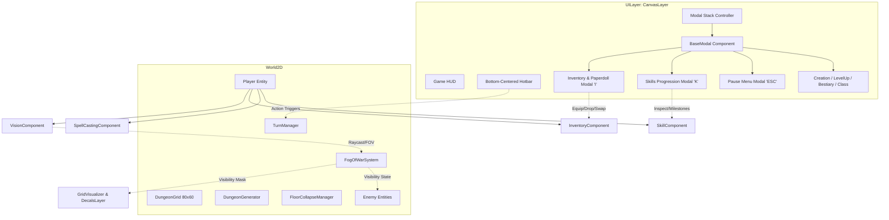
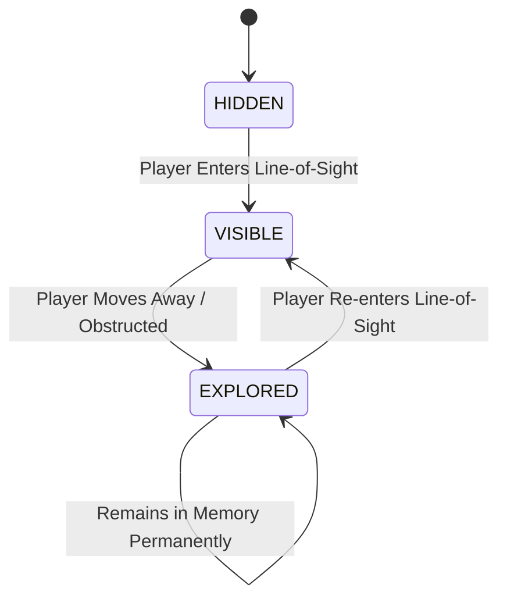
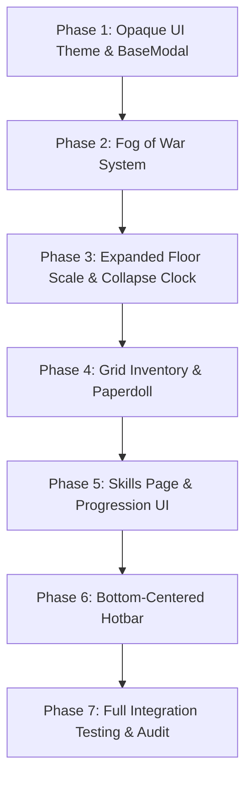

# Architecture Update: Next Batch Core Systems

**Project Name:** Trail of the Grandmaster  
**Engine:** Godot Engine 4.x (Forward+ / D3D12 / GDScript 2.0)  
**Document Version:** 1.0.0  
**Architect:** Lead Systems Architect (@architect)  
**Status:** Approved Architectural Blueprint for Implementation  

---

## Table of Contents
1. [Overview & Scope](#1-overview--scope)
2. [Opaque UI Themes & Modal Hierarchy](#2-opaque-ui-themes--modal-hierarchy)
3. [Fog of War & Vision System](#3-fog-of-war--vision-system)
4. [Expanded Floor Scale & Dynamic Collapse Timer](#4-expanded-floor-scale--dynamic-collapse-timer)
5. [Grid-Based Inventory & Anatomical Paperdoll](#5-grid-based-inventory--anatomical-paperdoll)
6. [Skills Page & Milestone Progression UI](#6-skills-page--milestone-progression-ui)
7. [Bottom-Centered Action Hotbar](#7-bottom-centered-action-hotbar)
8. [Developer Execution Roadmap & Implementation Steps](#8-developer-execution-roadmap--implementation-steps)

---

## 1. Overview & Scope

This architectural specification details the technical blueprints for the next six core game systems in *Trail of the Grandmaster*. The design maintains complete modularity, clean component separation, strict GDScript 2.0 type hinting, and adherence to Godot 4 node and UI conventions.



---

## 2. Opaque UI Themes & Modal Hierarchy

### 2.1 The Issue
Currently, various UI popups (`LevelUpModal`, `CharacterCreationModal`, `GameOverModal`, `ClassSelectionModal`) render with default Godot panel styling or partially transparent containers. When opened over a busy dungeon floor, tiles, lights, particles, and enemies bleed through the backgrounds, degrading legibility and visual polish.

### 2.2 Shared Theme Architecture: `OpaqueTheme`
A global UI theme and `StyleBoxFlat` configuration must be instituted for all game popups and sub-panels.

- **Theme Resource:** `res://resources/themes/opaque_ui_theme.tres`
- **Color Palette:**
  - **Backdrop Scrim:** `Color(0.02, 0.02, 0.04, 0.85)` (dimming overlay over dungeon).
  - **Modal Primary Background:** `Color(0.08, 0.09, 0.12, 1.0)` (Solid obsidian slate, 100% opacity).
  - **Modal Outer Border:** `Color(0.24, 0.28, 0.36, 1.0)` (2px solid border with 4px corner radius).
  - **Card / Sub-Panel Background:** `Color(0.12, 0.14, 0.18, 1.0)` (Solid dark charcoal, 100% opacity).
  - **Slot / Well Background:** `Color(0.05, 0.06, 0.08, 1.0)` (Solid inset well, 100% opacity).
  - **Header Accent Bar:** `Color(0.15, 0.18, 0.24, 1.0)` with Gold title `Color(1.0, 0.85, 0.3, 1.0)`.
  - **Button Normal:** `Color(0.14, 0.17, 0.22, 1.0)`, border `Color(0.30, 0.35, 0.45, 1.0)`.
  - **Button Hover / Focused:** `Color(0.20, 0.25, 0.34, 1.0)`, border `Color(0.45, 0.70, 1.0, 1.0)`.
  - **Button Pressed:** `Color(0.10, 0.12, 0.16, 1.0)`.

### 2.3 Base Modal Architecture (`res://scripts/ui/BaseModal.gd`)
All modal dialogs inherit from or compose a `BaseModal` node:

```gdscript
class_name BaseModal
extends PanelContainer

signal opened()
signal closed()

@export var modal_title: String = "MENU"
@export var close_on_escape: bool = true

var backdrop: ColorRect = null

func _ready() -> void:
    _setup_opaque_styling()
    _setup_backdrop()
    hide()

func open_modal() -> void:
    if backdrop:
        backdrop.show()
    show()
    move_to_front()
    emit_signal("opened")
    # Lock world input while modal is active
    var bus = _get_event_bus()
    if bus and bus.has_signal("modal_opened"):
        bus.emit_signal("modal_opened", self)

func close_modal() -> void:
    hide()
    if backdrop:
        backdrop.hide()
    emit_signal("closed")
    var bus = _get_event_bus()
    if bus and bus.has_signal("modal_closed"):
        bus.emit_signal("modal_closed", self)

func _unhandled_input(event: InputEvent) -> void:
    if visible and close_on_escape and event.is_action_pressed("ui_cancel"):
        close_modal()
        get_viewport().set_input_as_handled()
```

### 2.4 Modal Manager & Input Arbitration
In `World.gd` or `UIManager.gd`:
- Maintains a stack of open modals (`var open_modals: Array[BaseModal] = []`).
- While `open_modals.size() > 0`, `TurnManager.current_state` remains paused or input consumption blocks grid clicks and hotbar triggers.
- Click events over modals must set `mouse_filter = Control.MOUSE_FILTER_STOP` to guarantee no clicks pass to world grid cells.

---

## 3. Fog of War & Vision System

### 3.1 Three-State Visibility Model
The dungeon grid operates on a strict 3-tier visibility state machine for each grid cell:

```gdscript
enum TileVisibility {
    HIDDEN = 0,    # Unexplored: Shroud of pitch darkness; never seen.
    EXPLORED = 1,  # Memory: Previously visited; terrain remembered, entities hidden.
    VISIBLE = 2    # Direct Line of Sight: Currently illuminated; full color, entities visible.
}
```



### 3.2 Data Structure & `FogOfWarSystem.gd`
- **Location:** `res://scripts/world/FogOfWarSystem.gd` (attached as child to `World` or `DungeonGrid`).
- **Data storage:** A 1D `PackedByteArray` of size `width * height` for high-performance memory cache:
  - Index: `index = y * grid_width + x`.
  - Value: `0` (HIDDEN), `1` (EXPLORED), `2` (VISIBLE).
- **Key Methods:**
  - `init_fog(width: int, height: int) -> void`
  - `update_visibility(origin: Vector2i, sight_radius: int, grid: DungeonGrid) -> void`
  - `get_visibility(cell: Vector2i) -> TileVisibility`
  - `is_visible(cell: Vector2i) -> bool`
  - `is_explored(cell: Vector2i) -> bool`

### 3.3 Symmetric Shadowcasting / Bresenham Raycast
When the player takes a turn or moves:
1. **Transition Phase:** Iterate all cells currently marked `TileVisibility.VISIBLE` and demote them to `TileVisibility.EXPLORED`.
2. **Raycast / Shadowcast Phase:**
   - From `player.grid_pos`, cast rays across 360 degrees up to `view_distance_tiles` (base 8 tiles, adjusted by `PERCEPTION` skill and light gear).
   - If a ray encounters a `wall_cell`, mark that wall cell as `VISIBLE`, then terminate that ray.
   - All traversed floor/feature cells along unobstructed lines are marked `VISIBLE`.
3. **Signal Emission:** Emit `visibility_updated(visible_cells: Array[Vector2i])`.

### 3.4 Rendering Integration
- **`GridVisualizer.gd` Integration:**
  - `HIDDEN` cells: Do NOT draw floor tiles or decals. Wall cells are painted completely black `Color(0, 0, 0, 1)` or skipped.
  - `EXPLORED` cells: Draw floor and wall structures with a desaturated memory tint (`Color(0.25, 0.28, 0.35, 1.0)`), no grid line highlight, and no dynamic hover effects.
  - `VISIBLE` cells: Render in vibrant full palette, grid lines, and interactive hover outlines.
- **Entity & Prop Culling:**
  - **Enemies:** In `Enemy.gd` / `World.gd`, `enemy.visible = (fow_system.get_visibility(enemy.grid_pos) == TileVisibility.VISIBLE)`. Hidden enemies do not display health bars or play idle animations.
  - **Traps:** Traps only show if `is_revealed` AND cell is `VISIBLE`.
  - **Decals / Bloodstains:** Rendered only on `EXPLORED` and `VISIBLE` tiles, dimmed appropriately.
  - **Permanent Features:** Stairs, shrines, and open doorways remain permanently visible once in `EXPLORED` state.

---

## 4. Expanded Floor Scale & Dynamic Collapse Timer

### 4.1 Floor Dimension & Density Expansion
To provide grand exploration, tactical retreats, and meaningful risk/reward paths:
- **Grid Dimensions:** Increased from 48x36 to **80 columns × 60 rows** (4,800 total tiles, ~3.3x increase).
- **Room Count:** Scaled from 10 rooms to **18 – 24 rooms** per procedural floor (Floors 1–19).
- **Room Sizes:** Varied between 5x5 (small alcoves) to 14x14 (grand vaults, shrines, arenas).
- **Corridor Generation:** Double-elbow L-carving, loops, and optional secret detour corridors.
- **Floor 20 (Sanctum):** Retains its specialized hand-crafted grand arena (expanded to 48x48).

### 4.2 Dynamic Collapse Turn Budget Formula
A static 800-turn budget is ill-suited for variable layout sizes. The turn budget now dynamically computes based on floor topological mass:

$$\text{FloorTurns} = \text{BaseTurns} + \lfloor \text{WalkableTiles} \times \text{DensityWeight} \rfloor - (\text{FloorNumber} \times \text{FloorDecay})$$

**Parameter Specifications:**
- $\text{BaseTurns} = 300$
- $\text{DensityWeight} = 0.70$ turns per generated walkable tile
- $\text{FloorDecay} = 15$ turns per floor depth
- $\text{MinimumBudget} = 250$ turns

*Example Simulation:*
- Floor 1 (80x60, ~1,350 walkable tiles):
  $$300 + (1350 \times 0.70) - (1 \times 15) = 300 + 945 - 15 = 1,230 \text{ turns}$$
- Floor 10 (80x60, ~1,400 walkable tiles):
  $$300 + (1400 \times 0.70) - (10 \times 15) = 300 + 980 - 150 = 1,130 \text{ turns}$$
- Floor 19 (80x60, ~1,400 walkable tiles):
  $$300 + (1400 \times 0.70) - (19 \times 15) = 300 + 980 - 285 = 995 \text{ turns}$$

### 4.3 Proportional Collapse Stages
Rather than fixed absolute numbers, stages scale proportionately with total floor budget:

| Stage | Budget Remaining | Visual & Acoustic Events |
|---|---|---|
| **STABLE** | $> 50\%$ | Ambient dungeon synth; no tremors. |
| **TREMORS** | $25\% \text{ to } 50\%$ | Mild camera shake (intensity 0.20) every 25 turns; dust particles fall. |
| **COLLAPSING** | $10\% \text{ to } 25\%$ | Moderate camera shake (intensity 0.45) every 10 turns; audio groan; debris spawn. |
| **IMMINENT** | $1\% \text{ to } 10\%$ | Violent camera shake (intensity 0.75) every turn; flashing red vignette; urgent klaxon. |
| **COLLAPSED** | $\le 0$ turns | Total cave-in (intensity 1.0); instantaneous run wipe (`player_died`). |

---

## 5. Grid-Based Inventory & Anatomical Paperdoll

### 5.1 Overview
The inventory modal is bound to `'I'`. It combines a structured 2D grid backpack with an anatomical human paperdoll silhouette holding 12 dedicated equipment slots.

```
+---------------------------------------------------------------------------------+
|                               INVENTORY & EQUIPMENT                              |
+---------------------------------------+-----------------------------------------+
|             PAPERDOLL                 |             BACKPACK GRID (8x5)         |
|                                       |                                         |
|              [ HEAD ]                 |   [Slot 00] [Slot 01] [Slot 02] ...     |
|       [ BACK ]       [ ACCESSORY ]    |   [Slot 08] [Slot 09] [Slot 10] ...     |
| [ MAIN HAND ] [ BODY ] [ OFF HAND ]   |   [Slot 16] [Slot 17] [Slot 18] ...     |
|               [ BELT ]                |   [Slot 24] [Slot 25] [Slot 26] ...     |
|        [RING 1]      [RING 2]         |   [Slot 32] [Slot 33] [Slot 34] ...     |
|               [ LEGS ]                |                                         |
|               [ FEET ]                +-----------------------------------------+
|             [ AMMUNITION ]            | Carried Weight: 14.5 / 25.0 Stones      |
|                                       | Encumbrance: Normal (No Penalty)        |
+---------------------------------------+ Gold: 340 GP                            |
+---------------------------------------------------------------------------------+
```

### 5.2 Equipment Slot Taxonomy Expansion
`res://scripts/resources/ItemData.gd` expands `EquipSlot` to 12 anatomical positions:

```gdscript
enum EquipSlot {
    NONE = 0,
    HEAD = 1,
    BACK = 2,
    MAIN_HAND = 3,
    OFF_HAND = 4,
    BODY = 5,
    BELT = 6,
    LEGS = 7,
    FEET = 8,
    RING_1 = 9,
    RING_2 = 10,
    ACCESSORY = 11,
    AMMUNITION = 12
}
```

### 5.3 Drag-and-Drop & Slot Swapping Mechanics
Godot 4's native `Control` drag-and-drop virtual methods are implemented on `InventorySlotUI.gd`:
- **`_get_drag_data(at_position: Vector2)`:**
  - Returns a dictionary: `{"source_type": "backpack" | "paperdoll", "slot_index": int, "equip_slot": EquipSlot, "item": ItemData}`.
  - Generates a preview control (`TextureRect` or framed panel) offset at cursor.
- **`_can_drop_data(at_position: Vector2, data: Variant) -> bool`:**
  - For Paperdoll slots: Returns `true` if incoming `data.item.equip_slot == self.target_equip_slot` (or ring matching `RING_1`/`RING_2`).
  - For Backpack slots: Always returns `true`.
- **`_drop_data(at_position: Vector2, data: Variant) -> void`:**
  - Executes atomic swap or unequip/equip operation via `InventoryComponent`.

### 5.4 Right-Click Context Actions
- **Right-Clicking Item in Backpack:**
  1. Identifies item's designated `equip_slot`.
  2. If slot is `RING`:
     - Checks if `RING_1` is empty $\rightarrow$ equips to `RING_1`.
     - Else if `RING_2` is empty $\rightarrow$ equips to `RING_2`.
     - Else swaps into `RING_1` (old ring moves to backpack slot).
  3. For all other slots:
     - If slot is empty $\rightarrow$ moves item into slot.
     - If slot is occupied $\rightarrow$ atomic swap: equipped item moves into the clicked backpack cell, new item equips into paperdoll.
- **Right-Clicking Item in Paperdoll:**
  - Unequips item into the first available backpack slot.
  - If backpack is completely full, displays warning: *"Backpack is full! Cannot unequip."*

### 5.5 Item Hover Tooltip (`ItemTooltip.tscn`)
Floating contextual panel anchored adjacent to the hovered item slot without obscuring the cursor:
- **Title:** Item Name (color-coded by rarity/tier).
- **Sub-header:** Item Type & Slot (e.g. `Main Hand Weapon — One-Handed Sword`).
- **Combat Stats:** Base Damage `min - max`, Armor Value, Block %, Range, Accuracy bonus.
- **Modifiers:** Attribute boosts (e.g. `+2 STR`, `+5% Parry`).
- **Weight & Economy:** Weight in stones (`X.X stones`) and Base Gold Value (`X GP`).
- **Lore / Description:** Italicized flavour text.

---

## 6. Skills Page & Progression UI

### 6.1 Overview
The skills progression interface is keybound to `'K'`. It provides a comprehensive view of the player's 40+ skills, current decimal levels (`00.0` to `100.0`), tier badges, and milestone keystone perks.

```
+---------------------------------------------------------------------------------+
|                                 SKILLS & MASTERY                                |
+---------------------------------------+-----------------------------------------+
| SKILL DIRECTORY                       | SKILL DETAIL & MILESTONE TREE           |
|                                       |                                         |
| [Filter: All | Start | Meta | Class]  | [Icon] SWORDSMANSHIP                    |
|                                       | Current Level: 34.2 / 100.0 [STR / DEX] |
| > Swordsmanship        34.2 [STR]     | Progress to 34.3: [========---] 72%     |
|   Archery              12.0 [DEX]     |                                         |
|   Arcane Magic         08.5 [INT]     | Description:                            |
|   Perception           22.1 [WIS]     | Mastery of edged blades, slashing, and  |
|   Dodge                18.7 [AGI]     | tactical parrying in close-quarters.    |
|   Parry                15.0 [STR]     |                                         |
|   Brawling             05.0 [STR]     | KEYSTONE MILESTONES:                    |
|   Stealth              10.4 [DEX]     | [x] Level 25: Keen Edge (+10% Crit)    |
|   Meditation [META]    00.0 [WIS]     | [ ] Level 50: Blade Flourish (AoE Cleave|
|   Spellblade [CLASS]   00.0 [INT]     | [ ] Level 75: Riposte (Auto-counter)    |
|   ...                                 | [ ] Level 100: Grandmaster of Blades    |
+---------------------------------------+-----------------------------------------+
```

### 6.2 Visual Presentation Specifications
- **Decimal Display Format:** Formatted strictly via `%04.1f` (e.g., `05.0`, `34.2`, `100.0`).
- **Tier Identification Badges:**
  - `[STARTING]`: Soft Blue (`#4aa3df`)
  - `[META]`: Astral Purple (`#b366ff`)
  - `[CLASS-EXCLUSIVE]`: Ember Gold (`#e6a100`)
- **Governing Attribute Chips:** `[STR]`, `[DEX]`, `[CON]`, `[INT]`, `[WIS]`, `[CHA]` indicating primary scaling.

### 6.3 Milestone Keystone Nodes
For every selected skill, the right detail pane queries `SkillData.get_milestone_info(skill_id)`:
- **Milestone 25 (Novice Keystone):**
  - Displays title, mechanical benefit, and unlocked state.
- **Milestone 50 (Journeyman Keystone):**
  - Displays title, mechanical benefit, and unlocked state.
- **Milestone 75 (Expert Keystone):**
  - Displays title, mechanical benefit, and unlocked state.
- **Milestone 100 (Grandmaster Capstone):**
  - Displays title, mechanical benefit, and unlocked state.
- **Visual Styling:**
  - Unlocked: Gold border, bright glowing text, checkmark icon `[✓]`.
  - Locked: Muted charcoal border, 50% alpha text, padlock icon `[🔒]` with required level indicator.

---

## 7. Bottom-Centered Action Hotbar

### 7.1 Overview
A 10-slot horizontal bar permanently anchored to the bottom-center of the HUD, allowing quick-casting of spells and rapid use of consumables/throwables.

```
+-----------------------------------------------------------------------------------+
|  [ 1 ]    [ 2 ]    [ 3 ]    [ 4 ]    [ 5 ]    [ 6 ]    [ 7 ]    [ 8 ]    [ 9 ]  [ 0 ]|
| [Magic]  [Fire ]  [Blink]  [Minor]  [Health] [Throw]  [Empty]  [Empty]  [Empty][Empty]|
| [Missi]  [Ball ]  [     ]  [Heal ]  [Potion] [Knife]  [     ]  [     ]  [     ][     ]|
|  12 MP    28 MP    15 MP    10 MP     x3      x10                                  |
+-----------------------------------------------------------------------------------+
```

### 7.2 Keybindings & Slot Mapping
- Slots `1` through `9` correspond directly to top-row number keys `KEY_1` to `KEY_9`.
- Slot `10` corresponds to `KEY_0`.

### 7.3 Hotbar Slot Data Model
`res://scripts/resources/HotbarSlotData.gd`:
```gdscript
class_name HotbarSlotData
extends Resource

enum SlotContentType {
    EMPTY,
    SPELL,
    ITEM_CONSUMABLE,
    ITEM_THROWABLE
}

@export var content_type: SlotContentType = SlotContentType.EMPTY
@export var spell_data: SpellData = null
@export var item_id: String = ""
@export var slot_index: int = 0 # 0 through 9
```

### 7.4 Execution Pipeline
When a number key (`1`–`0`) is pressed during `TurnState.WAITING_FOR_INPUT` / `PLAYER_TURN`:
1. **Validation:** Check if slot has valid content.
2. **Resource Check:**
   - If Spell: Ensure `player.stats.current_mana >= spell.mana_cost`. If insufficient, play failure SFX and show *"Not enough mana!"* floating text.
   - If Consumable/Throwable: Ensure item exists in `player.inventory` with `quantity > 0`.
3. **Targeting Arbitration:**
   - **Self / Instant Effect (e.g. Minor Heal, Drink Potion, Arcane Shield):**
     - Executes immediately on the player.
     - Spends turn $\rightarrow$ advances to `TurnState.COMPANION_TURN` / `ENEMY_TURN`.
   - **Targeted Action (e.g. Magic Missile, Fireball AoE, Throwing Knife):**
     - Enters Grid Targeting State (`TargetingController`).
     - Renders range circle around player.
     - Tracing line/reticle to hovered grid cell.
     - Left-click confirms cast/throw onto target cell.
     - Right-click or ESC cancels targeting mode without spending a turn.

---

## 8. Developer Execution Roadmap & Implementation Steps

To ensure smooth delivery without regressions, the implementation is broken down into 6 sequential phases for `@developer`:



### Phase 1: Opaque UI Theme & BaseModal
- **Step 1.1:** Create `res://resources/themes/opaque_ui_theme.tres` with solid dark palettes (`#14171f`, `#1f2430`, 100% alpha).
- **Step 1.2:** Create `res://scripts/ui/BaseModal.gd` and base prefab `res://scenes/ui/menus/BaseModal.tscn`.
- **Step 1.3:** Refactor existing modals (`CharacterCreationModal`, `LevelUpModal`, `GameOverModal`, `VictoryModal`, `ClassSelectionModal`, `BestiaryModal`) to apply opaque styles and backdrop scrims.

### Phase 2: Fog of War System
- **Step 2.1:** Implement `res://scripts/world/FogOfWarSystem.gd` storing 3-state visibility (`HIDDEN`, `EXPLORED`, `VISIBLE`) in a `PackedByteArray`.
- **Step 2.2:** Connect `VisionComponent.gd` to update `FogOfWarSystem` on player grid steps using raycasting.
- **Step 2.3:** Update `GridVisualizer.gd` `_draw()` loop to respect cell visibility states (hidden = black, explored = dimmed memory, visible = full color).
- **Step 2.4:** Update `Enemy.gd` to cull visibility and health bars when not in `VISIBLE` cells.

### Phase 3: Expanded Floor Scale & Collapse Clock
- **Step 3.1:** Update `DungeonGenerator.gd` defaults to 80x60 grid with 18–24 rooms, larger room ranges (5x5 to 14x14).
- **Step 3.2:** Update `TurnManager.gd` to calculate `floor_total_turns` dynamically from generated walkable cells.
- **Step 3.3:** Update `FloorCollapseManager.gd` stage thresholds to percentage cutoffs (`50%`, `25%`, `10%`, `0%`).
- **Step 3.4:** Ensure `DungeonCamera.gd` limits and boundaries seamlessly accommodate the 80x60 dimensions.

### Phase 4: Grid-Based Inventory & Anatomical Paperdoll
- **Step 4.1:** Expand `ItemData.EquipSlot` in `ItemData.gd` to 12 slots (`HEAD, BACK, MAIN_HAND, OFF_HAND, BODY, BELT, LEGS, FEET, RING_1, RING_2, ACCESSORY, AMMUNITION`).
- **Step 4.2:** Update `InventoryComponent.gd` to support all 12 slots, equip/unequip helpers, and ring swap fallback logic.
- **Step 4.3:** Create `res://scenes/ui/menus/InventoryModal.tscn` & `res://scripts/ui/InventoryModal.gd`:
  - Left: Anatomical paperdoll slot layout with slot silhouette icons.
  - Right: 8x5 grid backpack container.
- **Step 4.4:** Implement drag-and-drop (`_get_drag_data`, `_can_drop_data`, `_drop_data`) and right-click auto-equip/swap.
- **Step 4.5:** Create `res://scenes/ui/components/ItemTooltip.tscn` for hover inspection.
- **Step 4.6:** Bind toggle key `'I'` in `World.gd` / `Player.gd`.

### Phase 5: Skills Page & Progression UI
- **Step 5.1:** Create `res://scenes/ui/menus/SkillsModal.tscn` & `res://scripts/ui/SkillsModal.gd`.
- **Step 5.2:** Populate left list with all player skills showing `%04.1f` decimal levels, category filter tabs, and tier badges.
- **Step 5.3:** Populate right detail sub-pane displaying lore, governing attribute, and Keystone Milestone cards (25, 50, 75, 100) with active/locked visual states.
- **Step 5.4:** Bind toggle key `'K'` in `World.gd` / `Player.gd`.

### Phase 6: Bottom-Centered Hotbar
- **Step 6.1:** Create `res://scenes/ui/components/HotbarSlotUI.tscn` and `res://scenes/ui/components/HotbarBar.tscn`.
- **Step 6.2:** Create `res://scripts/ui/HotbarBar.gd` managing 10 slots mapped to keys `1`–`0`.
- **Step 6.3:** Support drag-and-drop assignment of Spells (from Spellbook) and Consumables/Throwables (from Inventory) into hotbar slots.
- **Step 6.4:** Implement quick-action execution pipeline: direct execution for self/consumables, targeting reticle for ranged attacks/spells.

### Phase 7: Verification & Unit Tests
- **Step 7.1:** Write unit test suite `res://tests/test_phase8_core_systems.gd` verifying:
  - 12 equipment slots and ring-swapping logic.
  - Fog of War 3-state transitions and memory persistence.
  - Floor scale dynamic turn budget calculation.
  - Hotbar slot binding and execution.
- **Step 7.2:** Run test runner and verify 100% green passing results.

---
*End of Architectural Plan. Ready for Developer Implementation.*
